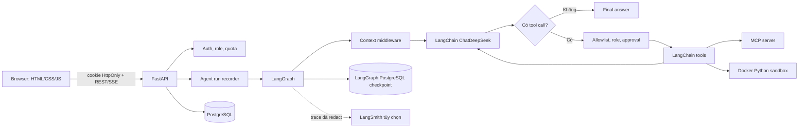

# Kiến trúc Personal AI Agent

## Phạm vi hiện tại

- Web đa tài khoản với role `user` và `admin`.
- Chat nhiều phiên, stream trạng thái qua SSE và lưu lịch sử trong PostgreSQL.
- Agent chạy bằng LangGraph; model/message/tool dùng LangChain; model hiện tại là DeepSeek.
- Tool nội bộ, MCP tool, Skill, user memory, approval, quota và checkpoint/resume.
- LangSmith tracing/eval là tùy chọn. RAG bằng LlamaIndex đang hoãn, chưa nằm trong production flow.

## Sơ đồ tổng thể

## Luồng một tin nhắn

1. `backend/routes/chat.py` xác thực user, conversation và quota rồi lưu message.
2. `agent_core/graph/runner.py` stream graph; `workflow.py` nối các node context → model → tool → model hoặc final.
3. `agent_core/context_middleware.py` ghép system, memory, history, tool và phần RAG rỗng theo token budget.
4. `agent_core/skills/middleware.py` chọn Skill và chỉ nạp hướng dẫn/tool cần thiết.
5. `agent_core/tools/executor.py` kiểm tra schema, allowlist, role, approval, timeout, retry và idempotency trước khi gọi tool.
6. LangGraph checkpoint theo thread/run để interrupt/resume; event được map sang SSE và timeline hiện tại.
7. `backend/services/agent_runs.py` lưu step, model usage, tool call, latency và lỗi đã redact.

## Dữ liệu và ranh giới an toàn

| Khu vực | Trách nhiệm |
| --- | --- |
| PostgreSQL ứng dụng | user, conversation, message, memory, agent run, usage, eval và audit |
| LangGraph checkpoint | trạng thái graph để resume theo thread/run |
| Cookie auth | JWT trong cookie HttpOnly; role được kiểm tra ở backend |
| Tool policy | allowlist, role, user approval, schema validation và giới hạn chạy |
| Python sandbox | container tạm, read-only root, network off, CPU/RAM/process/output limit |
| Observability | admin metrics, audit log, redaction; LangSmith dùng định danh ẩn danh khi bật |

Mọi truy vấn conversation/memory đều lọc theo `user_id`. Output từ tool và tài liệu được coi là dữ liệu không tin cậy, không phải system instruction.
Các bảng `checkpoint_*`/`checkpoints` do LangGraph quản lý và được loại khỏi Alembic autogenerate của ứng dụng.

## Thành phần chính

- `agent_core/contracts/`: DTO V2 version 1.0 và event union; validation độc lập với SDK/runtime.
  `Settings.v2_features` cung cấp master/feature flags mặc định tắt. Contract và ownership đã chốt
  tại [ADR 0001](docs/adr/0001-v2-contracts-and-layer-ownership.md), field/ví dụ ở
  [tài liệu contract](docs/contracts/README.md). Các adapter V2 sẽ được nối vào runtime theo từng mốc.
- `frontend/`: giao diện đăng nhập, chat, memory và admin.
- `backend/routes/`: HTTP/SSE boundary.
- `backend/services/`: nghiệp vụ, persistence, metrics, eval và tracing.
- `agent_core/graph/`: state, node, router, budget, interrupt/resume và streaming.
- `agent_core/tools/`, `agent_core/mcp/`, `agent_core/code_execution/`: tool runtime và sandbox.
- `agent_core/skills/`: registry, tìm kiếm và progressive disclosure.
- `evals/` và `scripts/run_evals.py`: dataset/rubric versioned và eval thật.

## Môi trường Docker dev

Docker dev đã có `compose.yaml` và hai target app/worker tại `infra/docker/app/Dockerfile`.
PostgreSQL/pgvector healthy → migration one-shot thành công → app/worker khởi động.
Migration tạo extension vector, nâng Alembic và setup schema LangGraph; runtime Docker dùng
`LANGGRAPH_CHECKPOINT_AUTO_SETUP=false`, còn luồng host giữ mặc định true.
PostgreSQL và tài liệu nằm ở hai named volume riêng; app/worker chia sẻ document volume,
chạy UID 10001 với root filesystem read-only. Worker health dựa trên heartbeat của execution loop.
Chi tiết và giới hạn profile: [Docker dev](infra/docker/app/README.md).

Dependency runtime/dev cùng dùng `uv.lock` trên Python 3.11.17/uv 0.13.1 cho Windows x64 và
Linux x86_64. Docker dùng image digest cố định và `uv sync --locked`. Workflow GitHub Actions
đã gỡ theo yêu cầu user ngày 2026-10-24; lint/unit và gate Compose chỉ chạy thủ công khi cần.
Các dataset V2 synthetic
chỉ là fixture nghiệm thu, không được runtime import để routing/retrieval/scheduling.
Chi tiết: [Dependency và kiểm tra thủ công](docs/DEPENDENCIES_AND_CI.md).

## Plugin metadata nền tảng

Ngày 80 đã có schema/namespace/host policy và snapshot versioned trong `agent_core/plugins/`;
xem [Plugin guide](docs/plugins/README.md) và [ADR 0002](docs/adr/0002-plugin-manifests-namespace-and-catalog.md).
Thư viện catalog thuần dữ liệu giữ snapshot trong memory. Ngày 81 có nguồn dữ liệu PostgreSQL
cho control API: catalog/history, grant scoped capability, connection theo owner và UUID credential
reference. Transaction + CAS + owner composite FK giữ nhất quán nhiều process; xem
[API guide](docs/plugins/API.md) và [ADR 0003](docs/adr/0003-plugin-persistence-and-user-ownership.md).
Ngày 82 thêm `agent_core/plugins/manager.py`: owner task theo stdio server, startup song song,
health/timeout/circuit breaker và registry batch atomic. Backend đọc manifest/profile host ở
`plugins/stdio/servers.json`; demo giữ alias V1. Xem [runtime guide](docs/plugins/STDIO_RUNTIME.md).
Registry host chưa nối với connection/grant theo user; credential resolver, HTTP/discovery và
Skill loading tiếp tục ở Ngày 83–85; connection configured trong DB chưa mở transport.

Ngày 83 thêm `MCPHTTPAdapter` dùng SDK Streamable HTTP, outbound transport kiểm tra URL/DNS
và ghim IP trong TCP backend, giữ TLS SNI gốc. Backend có encrypted secret/OAuth state (migration 0024),
PKCE/state/issuer/resource, refresh/revoke và private runtime factory pin owner/grant/reference.
Không publish credential user vào registry host. Chưa nối factory vào graph/UI tự động;
xem [HTTP/OAuth guide](docs/plugins/HTTP_AND_OAUTH.md) và [ADR 0005](docs/adr/0005-http-mcp-credentials-and-oauth.md).

Ngày 84: `agent_core.capability_catalog` index descriptor metadata, `ToolRegistry` tạo view theo
role/allowlist và cache schema theo registration. Selector fit definitions theo context token budget;
graph pin schema/registration đầu run, executor chặn generation đổi trước call/cache. Manager refresh
discovery tường minh, publish atomic hoặc withdraw riêng server lỗi. Catalog runtime không publish
private connection DB; Skill bridge/distributed invalidation chưa triển khai. Chi tiết:
[catalog guide](docs/plugins/CAPABILITY_CATALOG.md),
[ADR 0006](docs/adr/0006-capability-discovery-and-schema-budget.md).

Ngày 85: backend tạo run-local plugin runtime cho chat/SSE/resume; nối Skill package host-reviewed,
stdio binding đúng fingerprint và HTTP manager riêng theo owner. Core giữ dependency/approval,
package/schema/authority pin và guard trước model/cache/retry/RPC, sau RPC. Revoke hoặc generation
đổi yêu cầu run mới; checkpoint digest chặn pending approval/call cũ. Không thêm migration/cache
phân tán hoặc live session inventory. Xem [Skill runtime](docs/plugins/PLUGIN_SKILLS.md) và
[ADR 0007](docs/adr/0007-plugin-skills-and-run-authorization.md).

Ngày 86: frontend thêm UI Plugins/Connections theo owner/admin, dùng control API có sẵn và CAS
version snapshot. Backend chỉ bổ sung credential-slot metadata an toàn và POST OAuth state completion
cho callback HTML; không đổi runtime/transport/policy. Default flags vẫn tắt. Hai connector GitHub
đọc + web search và Skill research/report được hoãn theo yêu cầu. Xem [UI guide](docs/plugins/PLUGINS_UI.md).

Ngày 88 (phạm vi đầu): `agent_core/routing` có DecisionProvider và async Jev Choice adapter nhận
client từ caller; chưa factory/config/telemetry/model pin, mock contract hoặc nối graph. Không tạo
RoutingDecision với metadata giả. Selector V1 và default flags giữ nguyên; [chi tiết](docs/routing/README.md).

Ngày 89 bổ sung route taxonomy 1.0.0 và corpus 300 query song ngữ với split theo family,
validation input/scope/label/coverage và projection eval không chứa gold metadata. Module dataset
chỉ phục vụ offline/CI, không phân loại query hay chọn route cho graph. Xem [taxonomy](docs/routing/TAXONOMY.md).

Ngày 90: rules query router chạy sau runtime theo quyền, trước Skill/tool middleware và graph;
master/routing vẫn mặc định tắt. Chat enforce 0 tool/Skill, tool task giữ executor/approval cũ,
clarify lưu câu trả lời mà không gọi model. RAG/planner chưa có handler không thành available chỉ
nhờ flag. Checkpoint pin quyết định/policy/catalog, resume không re-route; SSE thêm event `routing`.
Không nối Jev; [guide](docs/routing/QUERY_ROUTER.md), [ADR 0008](docs/adr/0008-query-routing-before-graph.md).

Ngày 91 (code/injection): ShortlistRouter dùng DecisionProvider cho một Skill/tool hoặc none/
search_more; chỉ nạp schema/instructions đã chọn và chọn lại sau observation batch. Backend có
dependency mặc định None, không factory/key/SDK/lifecycle Jev. Graph pin choice/loaded schemas/
Skill/policy limits, resume pending action không reselect hoặc chuyển V1. Plugin Skill thêm
metadata guard riêng; quyền/approval/quota vẫn giữ nguyên. Rules 1.1.0 thêm đường Skill metadata
khi inject provider. [Guide](docs/routing/CAPABILITY_SHORTLIST.md),
[ADR 0009](docs/adr/0009-capability-shortlist-and-observation-routing.md).

## Phần chủ động chưa làm

- RAG/LlamaIndex ngày 69–73: đã mở lại theo M3, use case upload/tìm kiếm/hỏi đáp tài liệu riêng có citation.
- Redis cache: đã lên kế hoạch M5; background queue/checkpoint/quota hiện dựa trên PostgreSQL.
- Planner/sub-agent/song song: đã chốt boundary contract ở Ngày 77, runtime sẽ triển khai ở M4;
  đánh giá so với single-agent trước khi bật mặc định.

Chi tiết các mốc và trạng thái triển khai nằm trong [PROJECT_PLAN.md](PROJECT_PLAN.md).
