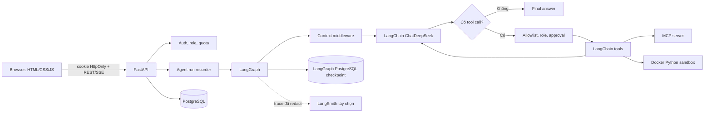

# Kiến trúc Personal AI Agent

## Phạm vi hiện tại

- Web đa tài khoản với role `user` và `admin`.
- Chat nhiều phiên, stream trạng thái qua SSE và lưu lịch sử trong PostgreSQL.
- Agent chạy bằng LangGraph; model/message/tool dùng LangChain; model hiện tại là DeepSeek.
- Tool nội bộ, MCP tool, Skill, user memory, approval, quota và checkpoint/resume.
- LangSmith tracing/eval là tùy chọn. RAG bằng LlamaIndex đang hoãn, chưa nằm trong production flow.

## Sơ đồ tổng thể

## Luồng một tin nhắn

1. `backend/routes/chat.py` xác thực user, conversation và quota rồi lưu message.
2. `agent_core/graph/runner.py` stream graph; `workflow.py` nối các node context → model → tool → model hoặc final.
3. `agent_core/context_middleware.py` ghép system, memory, history, tool và phần RAG rỗng theo token budget.
4. `agent_core/skills/middleware.py` chọn Skill và chỉ nạp hướng dẫn/tool cần thiết.
5. `agent_core/tools/executor.py` kiểm tra schema, allowlist, role, approval, timeout, retry và idempotency trước khi gọi tool.
6. LangGraph checkpoint theo thread/run để interrupt/resume; event được map sang SSE và timeline hiện tại.
7. `backend/services/agent_runs.py` lưu step, model usage, tool call, latency và lỗi đã redact.

## Dữ liệu và ranh giới an toàn

| Khu vực | Trách nhiệm |
| --- | --- |
| PostgreSQL ứng dụng | user, conversation, message, memory, agent run, usage, eval và audit |
| LangGraph checkpoint | trạng thái graph để resume theo thread/run |
| Cookie auth | JWT trong cookie HttpOnly; role được kiểm tra ở backend |
| Tool policy | allowlist, role, user approval, schema validation và giới hạn chạy |
| Python sandbox | container tạm, read-only root, network off, CPU/RAM/process/output limit |
| Observability | admin metrics, audit log, redaction; LangSmith dùng định danh ẩn danh khi bật |

Mọi truy vấn conversation/memory đều lọc theo `user_id`. Output từ tool và tài liệu được coi là dữ liệu không tin cậy, không phải system instruction.
Các bảng `checkpoint_*`/`checkpoints` do LangGraph quản lý và được loại khỏi Alembic autogenerate của ứng dụng.

## Thành phần chính

- `agent_core/contracts/`: DTO V2 version 1.0 và event union; validation độc lập với SDK/runtime.
  `Settings.v2_features` cung cấp master/feature flags mặc định tắt. Contract và ownership đã chốt
  tại [ADR 0001](docs/adr/0001-v2-contracts-and-layer-ownership.md), field/ví dụ ở
  [tài liệu contract](docs/contracts/README.md). Các adapter V2 sẽ được nối vào runtime theo từng mốc.
- `frontend/`: giao diện đăng nhập, chat, memory và admin.
- `backend/routes/`: HTTP/SSE boundary.
- `backend/services/`: nghiệp vụ, persistence, metrics, eval và tracing.
- `agent_core/graph/`: state, node, router, budget, interrupt/resume và streaming.
- `agent_core/tools/`, `agent_core/mcp/`, `agent_core/code_execution/`: tool runtime và sandbox.
- `agent_core/skills/`: registry, tìm kiếm và progressive disclosure.
- `evals/` và `scripts/run_evals.py`: dataset/rubric versioned và eval thật.

## Môi trường Docker dev

Docker dev đã có `compose.yaml` và hai target app/worker tại `infra/docker/app/Dockerfile`.
PostgreSQL/pgvector healthy → migration one-shot thành công → app/worker khởi động.
Migration tạo extension vector, nâng Alembic và setup schema LangGraph; runtime Docker dùng
`LANGGRAPH_CHECKPOINT_AUTO_SETUP=false`, còn luồng host giữ mặc định true.
PostgreSQL và tài liệu nằm ở hai named volume riêng; app/worker chia sẻ document volume,
chạy UID 10001 với root filesystem read-only. Worker health dựa trên heartbeat của execution loop.
Chi tiết và giới hạn profile: [Docker dev](infra/docker/app/README.md).

## Phần chủ động chưa làm

- RAG/LlamaIndex ngày 69–73: đã mở lại theo M3, use case upload/tìm kiếm/hỏi đáp tài liệu riêng có citation.
- Redis cache: đã lên kế hoạch M5; background queue/checkpoint/quota hiện dựa trên PostgreSQL.
- Planner/sub-agent/song song: đã chốt boundary contract ở Ngày 77, runtime sẽ triển khai ở M4;
  đánh giá so với single-agent trước khi bật mặc định.

Chi tiết các mốc và trạng thái triển khai nằm trong [PROJECT_PLAN.md](PROJECT_PLAN.md).
