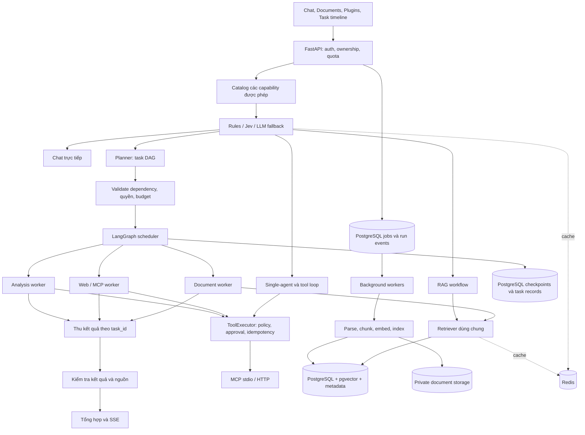

# Kế hoạch phát triển Personal AI Agent

Cập nhật: 2026-10-22

Mục tiêu: xây một web agent đa người dùng, có công cụ, RAG, memory, Skills, sandbox và trang quản trị đủ tốt để học và trình bày khi phỏng vấn.

Hướng mở rộng đã lập kế hoạch: plugin/MCP có thể cấu hình, Jev routing, thư viện tài liệu cá nhân,
planner và sub-agent chạy theo graph, Redis cache, Docker và CI/CD. Chi tiết ở phần
[Lộ trình mở rộng V2](#lộ-trình-mở-rộng-v2) bên dưới. Đây là kế hoạch triển khai, chưa phải các chức năng đã có.

Tiến độ: **M2: người dùng đã nghiệm thu Jev phân 4 route; đã gỡ bảng route/xác suất và nối quyết định vào luồng thật. Chat/tool_task dùng phần thực thi hiện có; document_qa/planned_task có điểm nhận chờ lõi. Đã sửa cuộn/xóa hội thoại và dòng nhắc cố định. Tiếp theo bàn thiết kế Choice chọn tool động. Ngày 87 và connector/Skill Ngày 86 tiếp tục hoãn theo yêu cầu**.
Kết quả và cảnh báo release: [Baseline Ngày 76](reports/baselines/2026-10-18-day76/BASELINE.md).
Tra cứu nhanh: [thứ tự các mốc](#3-thứ-tự-triển-khai-và-phạm-vi-từng-bản),
[mapping module](#4-mapping-module-và-dữ-liệu-dự-kiến),
[tiêu chí đo lường](#5-chiến-lược-đo-lường-và-phát-hành).

## Quy ước

- `[x]`: đã code và kiểm tra.
- `[ ]`: chưa hoàn thành.
- Một “ngày” là một buổi làm việc; có thể tách hoặc gộp khi cần.
- Chưa kiểm tra xong thì không chuyển task sang `[x]`.
- `PROJECT_NOTES.md` chỉ ghi công nghệ/kỹ thuật đã áp dụng thực tế.
- Khi hoàn thành một task: ghi cách triển khai, kiểm tra đã chạy và giới hạn còn lại vào notes;
  cập nhật checkbox và mục Task tiếp theo trong cùng lượt làm việc.
- Tài liệu tham khảo chính: `Hiểu sâu về AI Agent.pdf`.

## Nguyên tắc hiển thị hoạt động của agent

- Không hiển thị hoặc lưu suy luận nội bộ nguyên văn.
- Chỉ hiển thị: trạng thái, kế hoạch ngắn, bước đang chạy, tên tool, tham số đã lọc, kết quả tóm tắt và lỗi.
- Tool có tác động ghi/xóa/gửi dữ liệu phải xin user xác nhận.

## Phần nền tảng đã hoàn thành

- [x] Đăng ký, đăng nhập và đăng xuất.
- [x] Phân quyền `user` và `admin`.
- [x] PostgreSQL lưu user, phiên chat và message.
- [x] Mỗi user có nhiều phiên chat và chỉ thấy dữ liệu của mình.
- [x] Chat cơ bản với DeepSeek và streaming SSE.
- [x] Context dùng system prompt và 20 message gần nhất.
- [x] Lưu token, thời gian và trạng thái gọi model cơ bản.
- [x] Tạo file kế hoạch và quy ước cập nhật tiến độ.

## Giai đoạn 1 — Tool, MCP và Agent Harness

Tham khảo sách: Chương 1.2, 2.2, 2.4 và 4.

- [x] Ngày 01: Tạo `ToolSpec`, `ToolResult`, `ToolContext` và Tool Registry.
- [x] Ngày 02: Tạo bảng `agent_runs`, `run_steps`, `tool_calls`.
- [x] Ngày 03: Xây vòng lặp model → tool → observation → model.
- [x] Ngày 04: Thêm giới hạn step, token, thời gian và điều kiện dừng.
- [x] Ngày 05: Stream event trạng thái của agent ra frontend.
- [x] Ngày 06: Làm timeline UI cho từng bước và từng tool call.
- [x] Ngày 07: Tích hợp MCP client và kết nối một MCP server thử nghiệm.
- [x] Ngày 08: Thêm 2–3 tool nhỏ, dễ kiểm chứng.
- [x] Ngày 09: Thêm schema validation, timeout, retry và idempotency.
- [x] Ngày 10: Thêm allowlist, phân quyền tool và bước user phê duyệt.
- [x] Ngày 11: Test vòng lặp, lỗi tool, từ chối quyền và prompt injection.

Hoàn thành khi: agent gọi được tool qua cùng một interface, UI theo dõi được từng bước và lỗi không làm hỏng phiên chat.

## Giai đoạn 2 — Context Engineering

Tham khảo sách: Chương 2.3–2.7.

- [x] Ngày 12: Đo token của từng phần context và đặt token budget.
- [x] Ngày 13: Tách Context Builder thành system, memory, history, tools và RAG.
- [x] Ngày 14: Ổn định prefix, version prompt và theo dõi prompt-cache hit.
- [x] Ngày 15: Chỉ nạp tool phù hợp; lazy-load khi số tool tăng.
- [x] Ngày 16: Thêm status block: mục tiêu, tiến độ, việc còn lại và budget.
- [x] Ngày 17: Nén message cũ theo tầng và lưu bản tóm tắt có version.
- [x] Ngày 18: Test mất thông tin trước/sau nén context.

Hoàn thành khi: context có ngân sách rõ ràng, không luôn nhét toàn bộ lịch sử/tool và bản nén vượt qua bộ test hồi quy.

## Giai đoạn 3 — RAG tài liệu

Tham khảo sách: Chương 3.2 và 3.3.

Trạng thái: use case đã rõ từ 2026-10-18: user upload tài liệu riêng, tìm kiếm và hỏi đáp có nguồn.
Ngày 19–27 là checklist yêu cầu cũ; thực hiện bằng LlamaIndex theo M3, Ngày 96–108 của V2.
Không tính các ngày này thành một đợt triển khai riêng.

- [ ] Ngày 19: Thiết kế source/document/chunk và quyền sở hữu tài liệu.
- [ ] Ngày 20: Làm upload, parse và chunking baseline có metadata.
- [ ] Ngày 21: Tạo embedding, lưu vector bằng `pgvector` và đánh index.
- [ ] Ngày 22: Làm tìm kiếm từ khóa và benchmark phương án BM25.
- [ ] Ngày 23: Kết hợp dense + keyword/BM25 bằng hybrid search/RRF.
- [ ] Ngày 24: Thêm query rewrite, rerank và lọc theo user.
- [ ] Ngày 25: Trả lời kèm citation tới document/chunk nguồn.
- [ ] Ngày 26: Tạo bộ câu hỏi đánh giá Recall@K, MRR và độ đúng câu trả lời.
- [ ] Ngày 27: Test chống truy cập chéo tài liệu giữa các user.

Hoàn thành khi: hybrid retrieval tốt hơn baseline trên bộ câu hỏi và mọi truy vấn đều lọc theo quyền user.

## Giai đoạn 4 — Memory và cá nhân hóa

Tham khảo sách: Chương 3.1.

- [x] Ngày 28: Thiết kế user memory có loại, nguồn, thời gian và confidence.
- [x] Ngày 29: Trích xuất preference/fact có kiểm tra trùng và xung đột.
- [x] Ngày 30: Truy xuất memory phù hợp và chèn theo token budget.
- [x] Ngày 31: Cho user xem, sửa, ghim và xóa memory.
- [x] Ngày 32: Thêm retention, dữ liệu nhạy cảm và test riêng tư.

Hoàn thành khi: cá nhân hóa có thể giải thích nguồn và user kiểm soát được dữ liệu ghi nhớ.

## Giai đoạn 5 — Skills

Tham khảo sách: Chương 2.5 và 4.3–4.4.

- [x] Ngày 33: Định nghĩa định dạng Skill gồm metadata, hướng dẫn và tool cần dùng.
- [x] Ngày 34: Tạo Skill Registry, tìm kiếm và progressive disclosure.
- [x] Ngày 35: Viết hai Skill mẫu giải quyết tác vụ nhiều bước.
- [x] Ngày 36: Đánh giá chọn đúng Skill và tuân thủ hướng dẫn.

Hoàn thành khi: thêm Skill mới không cần sửa lõi agent và agent chỉ nạp Skill phù hợp.

## Giai đoạn 6 — Chạy code an toàn

Tham khảo sách: Chương 4.6 và 5.1–5.2.

- [x] Ngày 37: Viết threat model và hợp đồng cho `run_python_code`.
- [x] Ngày 38: Tạo sandbox container, filesystem tạm và tắt network mặc định.
- [x] Ngày 39: Giới hạn CPU, RAM, thời gian, process và kích thước output.
- [x] Ngày 40: Trả stdout, stderr và artifact đã kiểm tra về agent.
- [x] Ngày 41: Test đọc secret, thoát sandbox, fork bomb và truy cập mạng.

Hoàn thành khi: code chỉ chạy trong môi trường cô lập, có quota và vượt qua test tấn công cơ bản.

## Giai đoạn 7 — Tác vụ dài và độ tin cậy

Tham khảo sách: Chương 1.2 và 6.

- [x] Ngày 42: Thêm hàng đợi background; dùng Redis nếu phù hợp sau khi thử nghiệm.
- [x] Ngày 43: Hỗ trợ cancel, retry có kiểm soát và idempotency key.
- [x] Ngày 44: Lưu checkpoint để resume agent run sau lỗi.
- [x] Ngày 45: Thêm rate limit, quota và cơ chế chống chạy lặp vô hạn.

Hoàn thành khi: tác vụ dài có thể theo dõi, hủy, thử lại và phục hồi an toàn.

## Giai đoạn 8 — Evaluation, Admin và vận hành

Tham khảo sách: Chương 7 và 9.

- [x] Ngày 46: Tạo eval dataset và rubric cho chat, tool, RAG và safety.
- [x] Ngày 47: Chạy eval tự động và lưu kết quả theo version model/prompt.
- [x] Ngày 48: Tính pass rate, tool success rate và failure category.
- [x] Ngày 49: Trang admin xem token, turn, tool call, latency và lỗi.
- [x] Ngày 50: Trang admin xem pass rate và so sánh các phiên bản.
- [x] Ngày 51: Thêm chi phí, cache hit, P50/P95 và drill-down agent run.
- [x] Ngày 52: Redact log, retention policy, audit log và cảnh báo.
- [x] Ngày 53: Test end-to-end, backup/restore và viết tài liệu vận hành.

Lưu ý: `pass rate` được tính từ eval dataset có đáp án/rubric, không lấy từ cảm nhận của model.

## Giai đoạn 9 — Chuyển sang LangChain, LangGraph, LlamaIndex và LangSmith

Tham khảo sách: Chương 1–3, 6, 7 và 9; đối chiếu tài liệu chính thức của từng framework.

Phân chia trách nhiệm:

- LangChain: model, message, tool và structured output.
- LangGraph: state, workflow, checkpoint, resume, approval và streaming.
- LlamaIndex: ingestion, chunking, index, retrieval và citation cho RAG.
- LangSmith: tracing, dataset, evaluation và theo dõi lỗi.

Nguyên tắc migration: chuyển từng phần, giữ API/UI và dữ liệu hiện tại; chỉ xóa code cũ sau khi phần thay thế vượt qua test.

Mapping đã chốt:

| Phần hiện tại | Framework thay thế | Ngày |
| --- | --- | --- |
| DeepSeek client và model message | LangChain `ChatDeepSeek` + message | 55 |
| `ToolSpec`, schema và handler | LangChain tool + Pydantic | 56 |
| `agent_loop.py` | LangGraph `StateGraph` + node/edge | 57–59 |
| Event của agent | LangGraph stream → SSE hiện tại | 60 |
| Tool approval manager | LangGraph interrupt/resume | 61 |
| Agent checkpoint tự viết | LangGraph PostgreSQL checkpointer | 62 |
| Context builder và history compression | LangChain message/middleware | 63 |
| Memory retrieval/injection | LangGraph state/store adapter | 64 |
| Skill selection/instructions | Dynamic prompt/tool middleware | 65 |
| Retry, timeout và cancel trong loop | LangGraph node policy/control | 66 |
| Model/tool trace tự ghi | LangSmith tracing; giữ audit nghiệp vụ | 67 |
| Eval runner/dataset tự viết | LangSmith dataset/experiment | 68 |
| RAG contract chưa triển khai | LlamaIndex ingestion/retriever/citation | 69–73 |

Dependency đã khóa theo minor: LangChain 1.4, LangGraph 1.2, PostgreSQL checkpointer 3.1, LangSmith 0.14 và LlamaIndex Core 0.14.

- [x] Ngày 54: Chốt dependency, version và sơ đồ mapping code cũ sang framework mới.
- [x] Ngày 55: Thay DeepSeek client bằng LangChain chat model, message và streaming usage.
- [x] Ngày 56: Chuyển ToolSpec/tool handler sang LangChain tool và Pydantic schema.
- [x] Ngày 57: Tạo LangGraph `AgentState` và các node context, model, tool, final.
- [x] Ngày 58: Thay agent loop bằng graph có conditional edge model → tool → model.
- [x] Ngày 59: Chuyển step/token/time budget và chống lặp vào state/router của graph.
- [x] Ngày 60: Map LangGraph streaming event sang SSE và timeline hiện tại.
- [x] Ngày 61: Chuyển user approval sang LangGraph interrupt/resume, giữ phân quyền và audit.
- [x] Ngày 62: Dùng LangGraph PostgreSQL checkpointer cho checkpoint và resume theo thread/run.
- [x] Ngày 63: Chuyển context assembly sang LangChain message/middleware, giữ token budget.
- [x] Ngày 64: Nối user memory PostgreSQL vào LangGraph state/store và giữ privacy/retention.
- [x] Ngày 65: Chuyển Skill selection và progressive disclosure sang dynamic prompt/tool middleware.
- [x] Ngày 66: Chuyển retry, cancel, timeout và lỗi node sang cơ chế điều khiển của LangGraph.
- [x] Ngày 67: Tích hợp LangSmith tracing có tag run/user ẩn danh và redact dữ liệu nhạy cảm.
- [x] Ngày 68: Đưa eval dataset/rubric hiện tại vào LangSmith và lưu kết quả experiment.
- [ ] Ngày 69: Dùng LlamaIndex ingestion pipeline cho document, node, metadata và chunking.
- [ ] Ngày 70: Dùng LlamaIndex embedding/index với pgvector và bộ lọc quyền theo user.
- [ ] Ngày 71: Thêm dense + BM25, fusion/rerank và query rewrite qua LlamaIndex retriever.
- [ ] Ngày 72: Tạo LangGraph RAG node gọi LlamaIndex retriever và trả citation.
- [ ] Ngày 73: Test Recall@K, MRR, citation và chống truy cập chéo tài liệu.
- [x] Ngày 74: Xóa agent loop/tool/context/checkpoint cũ đã được framework thay thế.
- [x] Ngày 75: Chạy E2E, safety, eval, cập nhật kiến trúc và tài liệu trình bày phỏng vấn.

Ghi chú: Ngày 69–73 được mở lại theo M3 của V2. Mapping nghiệm thu:
69 → 96–100; 70 → 101; 71 → 102–104; 72 → 105–106; 73 → 107–108.
Chỉ tick các mục cũ khi phần tương ứng đã chạy và kiểm tra; không cộng thêm vào ước lượng V2.

Hoàn thành phần migration hiện tại khi: production chạy bằng LangGraph; model/tool dùng LangChain;
trace/eval hỗ trợ LangSmith; không còn runtime tự viết trùng chức năng. Tiêu chí RAG dùng LlamaIndex
sẽ áp dụng khi tiếp tục ngày 69–73.

## Lộ trình mở rộng V2

### 1. Hiện trạng và mục tiêu sản phẩm

Đã đối chiếu kế hoạch/notes với code ngày 2026-10-18; chưa chạy lại release gate trong lượt lập kế hoạch.
Các checkbox hoàn thành ở phần trên giữ nguyên lịch sử nghiệm thu trước đó.

| Thành phần | Hiện trạng đọc từ code | Việc cần bổ sung |
| --- | --- | --- |
| MCP | Stdio demo hiện tại; đã có manifest/namespace/host policy và catalog metadata versioned | DB/connection/grant, nhiều server, HTTP, credential riêng, quản lý vòng đời |
| Chọn tool/Skill | Chấm điểm từ khóa trong `tools/selector.py`, `skills/selector.py`; có lazy loading | Catalog retrieval, Jev, fallback và khám phá thêm tool giữa run |
| Graph | `graph/workflow.py` có context/model/approval/tool/final, checkpoint PostgreSQL | Nhánh RAG, planner, DAG task, worker subgraph, fan-out/fan-in |
| RAG | Có dependency LlamaIndex và context contract; chưa có upload/retrieval thực tế | Ingestion, pgvector, lexical search, citations, UI và eval |
| Background | PostgreSQL queue, lease/heartbeat, retry và idempotency | Job ingestion và job agent dài; event replay cho UI |
| Cache | Prompt cache của provider; một số cache trong process | Redis cache chia sẻ, có version và cô lập user |
| Deploy | Docker app/worker, Compose dev PostgreSQL/pgvector, uv.lock và CI lint/unit/migration/integration; sandbox và backup riêng | CI chạy trên GitHub sau push workflow, CD và Docker production |

Sản phẩm đích có bốn luồng demo kiểm chứng được:

1. User kết nối plugin, bật Skill, hỏi một tác vụ; hệ thống tìm và nạp đúng tool được phép.
2. User upload PDF/DOCX/TXT/Markdown, theo dõi xử lý, tìm kiếm và hỏi đáp trong tài liệu đã chọn,
   mở được đoạn nguồn cùng trang/mục tương ứng.
3. User yêu cầu so sánh tài liệu A/B với thông tin trên web: planner chia task; các nhánh độc lập
   chạy song song; kết quả tổng hợp có nguồn, trạng thái từng task, nút hủy và tiếp tục khi lỗi.
4. Một release chạy được trên máy sạch bằng Docker; CI kiểm tra trước khi phát hành;
   staging có smoke test và có quy trình rollback được diễn tập.

### 2. Kiến trúc đích và ranh giới trách nhiệm



Các node RAG/chat/tool trả kết quả qua cùng recorder/SSE/final contract; sơ đồ chỉ rút gọn các cạnh này.

| Lớp | Quyết định cho V2 |
| --- | --- |
| LangGraph | Điều phối duy nhất cho run, task dependency, interrupt/resume và workflow |
| LangChain | Chat model, structured output, message và tool adapter hiện tại |
| Jev | Quyết định có tập lựa chọn: route, Skill, shortlist tool; tùy chọn đánh giá evidence |
| LlamaIndex | Parse/chunk/index/retriever adapter; trả evidence có cấu trúc cho LangGraph |
| PostgreSQL | Nguồn dữ liệu chính: quyền, document version, job, task, event, checkpoint, quota |
| Redis | Cache có thể tái tạo; có thể báo có event mới, còn replay đọc dữ liệu bền vững |
| Storage | Bản đầu dùng private volume qua `DocumentStorage` interface; có thể thay bằng S3-compatible |
| LangSmith + admin | Theo dõi route/retrieval/task/cache, eval versioned và chi phí toàn run |

Plugin là gói metadata, cấu hình kết nối MCP và Skill; MCP là giao thức kết nối tool;
Skill mô tả cách giải một loại công việc. Một Skill có thể cần tool từ nhiều plugin.
Giữ định dạng `skill.json` + `instructions.md` đã có; chưa cần đổi toàn bộ sang định dạng khác.

### 3. Thứ tự triển khai và phạm vi từng bản

| Mốc | Task | Phụ thuộc | Bản chạy được sau khi hoàn thành |
| --- | --- | --- | --- |
| M0 | 76–79 | Nền tảng hiện có | Baseline, contract V2, Docker dev và CI cơ bản |
| M1 | 80–87 | M0 | Thêm plugin/MCP qua manifest và UI, tìm tool theo nhu cầu |
| M2 | 88–95 | M1 | Jev route query/chọn Skill/tool, có fallback và eval |
| M3 | 96–108 | M0; nối M1/M2 khi xong | Upload, tìm kiếm, RAG có citation và kiểm tra quyền |
| M4 | 109–119 | M1–M3 | Planner, worker subgraph, task DAG, chạy song song và resume |
| M5 | 120–124 | M2–M4 có baseline đo | Redis cache và invalidation có kiểm thử |
| M6 | 125–133 | M0–M5 | CI/CD, staging, crash/load test và rollback |

58 đơn vị công việc là khung chia task, không phải cam kết 58 ngày lịch. Ước lượng sơ bộ
3–5 giờ/đơn vị: khoảng 174–290 giờ, cộng 20–30% dự phòng cho tương thích SDK, parser,
OAuth và lỗi concurrency. Hiệu chỉnh sau M0 và mỗi mốc; task dài cần tách thêm trước khi code.
Docker/CI được khởi động ở M0 và bổ sung service/test xuyên suốt, không chờ M6 mới kiểm tra tích hợp.

Ưu tiên bản đầu: M0 → M1 → M2 → M3. M4 tạo khả năng xử lý yêu cầu phức tạp;
M5 tối ưu theo số liệu; M6 hoàn thiện phát hành. Nếu Jev chưa đạt quality gate, tiếp tục dùng
fallback để các mốc khác vẫn triển khai được. Route RAG/planner chỉ xuất hiện khi capability đã sẵn sàng.

### M0 — Baseline, contract và môi trường tái lập

- [x] Ngày 76: Chạy lại regression gate trong `OPERATIONS.md`, lưu baseline pass rate/latency/token; kiểm tra trạng thái Git/repo, dependency và Docker trên máy hiện tại.
- [x] Ngày 77: Chốt contract `CapabilityDescriptor`, `RoutingDecision`, `RetrievalResult`, `TaskSpec`, event; feature flag mặc định tắt và ADR mô tả ownership giữa các lớp. (contract là quy định dữ liệu được trao đổi phải có những trường nào, kiểu gì và điều kiện hợp lệ)
- [x] Ngày 78: Tạo Dockerfile app/worker và Compose dev với PostgreSQL có pgvector; volume dữ liệu riêng, healthcheck, migration one-shot; xác minh startup từ máy sạch.
- [x] Ngày 79: Khóa dependency tái lập, dựng CI lint/unit/migration/integration nền tảng; tạo fixture/dataset khung cho routing, retrieval và task orchestration.

Nghiệm thu: luồng chat/demo tool/memory chạy qua Compose và vượt regression gate tương ứng;
tắt toàn bộ feature flag V2 vẫn chạy các luồng này. Sandbox được kiểm tra riêng theo runbook
cho đến khi tích hợp runner ở M6. CI offline không cần key model. Repo đích đã xác định là
`Bo2874/Agent_Project`; workflow Ngày 79 cần commit/push để tạo GitHub Actions run đầu tiên.

Kết quả Ngày 76 (2026-10-18): pytest 343/343 pass sau khi chạy MCP ngoài Windows sandbox;
Skill selection 13/13, adherence 2/2; E2E DeepSeek, migration, backup/restore, checkpoint và Docker
sandbox checks đạt. Eval smoke 2/2 pass, P50 1.442,50 ms, P95 1.613,05 ms, agent + judge 2.973 token.
Các thống kê latency/token chỉ thuộc hai case smoke, không đại diện toàn dataset hay tải production.
Admin còn critical `stuck_agent_runs` từ một run ngày 01/10; baseline đã ghi nhận, release checklist
chưa sạch. Chưa có Git repo/lockfile; 26 dependency trực tiếp đúng constraints, `pip check` đạt.
Chi tiết: [báo cáo và bằng chứng](reports/baselines/2026-10-18-day76/BASELINE.md).

Kết quả Ngày 77 (2026-10-18): đã triển khai `agent_core/contracts/`, schema version 1.0,
JSON validation/schema, năm event kind có typed envelope; `Settings.v2_features` và 8 biến env
mặc định false (master + 7 feature). Có dependency planning → routing, parallel → planning.
ADR đã chốt ownership, trust boundary, event scope và đường tích hợp với graph/SSE hiện tại.
Kiểm tra: Ruff đạt; 65 test mới đạt; toàn bộ 407 test offline + 1 MCP ngoài sandbox đạt.
Chi tiết: [contract V2](docs/contracts/README.md) và
[ADR 0001](docs/adr/0001-v2-contracts-and-layer-ownership.md).

Kết quả Ngày 78 (2026-10-18): hai target Docker app/worker, Compose dev có PostgreSQL 17/pgvector,
hai named volume riêng, healthcheck app/worker và migration one-shot sở hữu Alembic/checkpoint DDL.
Cold build không dùng host `.env`/`.venv`; image cuối startup trên project/volume mới, đủ 22 migration.
HTTP E2E, memory API, worker job, graph/MCP/checkpoint, schema drift và persistence qua down/up đạt;
migration exit 17 chặn app/worker khởi động. Ruff và 421/421 regression test đạt.
Đây là kiểm tra môi trường Docker sạch trên máy hiện tại; live LLM eval và production deploy chưa thuộc lượt này.
Chi tiết: [nghiệm thu Ngày 78](reports/checks/2026-10-18-day78/STARTUP.md),
[runbook Docker dev](infra/docker/app/README.md).

Kết quả Ngày 79 (2026-10-18): uv.lock khóa 137 package entry cho Python 3.11.17/uv 0.13.1,
Windows x64 và Linux x86_64; Docker dùng lock cùng image digest. Workflow pin action SHA, có
actionlint, lint/unit matrix và migration/integration Compose không cần model key.
Local gate: Windows 438/438, Linux Docker 438/438; Skill selection 13/13, adherence 2/2;
migration/drift/idempotence, queue/checkpoint, HTTP/memory, persistence và migration failure gate đạt.
Có 21 fixture V2 synthetic (8 routing, 7 retrieval, 6 orchestration), 17 test mới; chưa đo quality runtime V2.
Chưa push workflow mới/chưa có GitHub Actions run cho thay đổi này; local equivalent gates đã đạt.
Chi tiết: [nghiệm thu Ngày 79](reports/checks/2026-10-18-day79/VALIDATION.md),
[dependency/CI](docs/DEPENDENCIES_AND_CI.md), [dataset scaffold](evals/datasets/foundation/README.md).

Cập nhật 2026-10-24: theo yêu cầu user, đã gỡ `.github/workflows/ci.yml` (Foundation CI).
Sau khi commit/push thay đổi này, repo không còn workflow tự chạy lint/unit/integration khi push/PR.
Các kết quả CI/gate phía trên là lịch sử; kiểm thử tiếp theo do user chạy thủ công khi cần.

### M1 — Plugin platform và nhiều MCP server

Thiết kế:

- `PluginManifest`: `id`, `version`, mô tả, capability tags, danh sách MCP server, Skill đi kèm,
  tool policy do ứng dụng quản lý, secret reference, giới hạn concurrency và schema version.
  Manifest là định dạng của project; không coi đó là chuẩn đóng gói chung của mọi MCP server.
- Admin đăng ký manifest/package đã kiểm tra. User bật/tắt plugin và kết nối tài khoản của mình.
  Stdio chỉ chạy executable/args được admin cấu hình, có pin version, không nhận shell command từ chat.
- `PluginManager` quản lý start/stop/health/timeout/circuit breaker; một server lỗi không làm hỏng
  toàn bộ startup. Registry cập nhật snapshot nguyên tử; disable/revoke tăng catalog/auth version.
- Có stdio và Streamable HTTP. Pin và kiểm tra phiên bản SDK/protocol với từng server;
  xử lý phân trang catalog, cơ chế refresh/thay đổi catalog theo version đã thương lượng.
  Tài liệu MCP hiện hành có thay đổi so với giao thức session cũ, nên cần compatibility test
  thay vì sao chép nguyên ví dụ của một SDK khác. [MCP transports](https://modelcontextprotocol.io/specification/latest/basic/transports)
- Credential scope theo user/connection; secret không nằm trong manifest, prompt hoặc checkpoint.
  Bản đầu hỗ trợ API key/token lưu mã hóa phía server; HTTP OAuth triển khai theo provider và
  [MCP authorization](https://modelcontextprotocol.io/specification/latest/basic/authorization), có state/PKCE khi áp dụng,
  refresh/revoke và kiểm tra token audience. Không dùng token user A cho user B.
- Endpoint remote được kiểm tra scheme/host/redirect/DNS để tránh SSRF; backend quản lý phạm vi
  truy cập. Annotation từ MCP server là tín hiệu mô tả, quyền gọi/ghi/retry do policy tin cậy của host quyết định.
- Catalog index chỉ dùng metadata: tên, mô tả, tag, ví dụ, input/output schema reference.
  M1 dùng lexical search trên metadata; có thể bổ sung embedding catalog sau M3 mà giữ nguyên interface.
  Lọc user/role/connection trước khi shortlist. Tool discovery hỗ trợ `search_tools`/`load_tool`
  giữa run; executor kiểm tra quyền lần nữa khi gọi, kể cả tool từng được cache/nạp trước đó.
- Skill được namespace theo plugin, kiểm tra `required_tools`, version compatibility;
  chỉ nạp instructions và 4–8 schema cần thiết theo token budget. Không nạp toàn bộ catalog vào prompt.

Plugin mẫu: giữ demo để test tương thích; thêm [GitHub MCP chính thức](https://github.com/github/github-mcp-server)
với phạm vi đọc và [Tavily MCP](https://docs.tavily.com/documentation/mcp) cho web search/extract.
Kết nối thật cần tài khoản/key do người triển khai cấu hình; test CI dùng fixture cùng contract.
Output web có URL, thời điểm lấy, title và đoạn nội dung để phục vụ citation; giới hạn fetch/output.

- [x] Ngày 80: Định nghĩa/validate manifest, namespace và policy; tạo catalog plugin có version.
- [x] Ngày 81: Tạo bảng plugin/connection/grant, credential reference và API bật/tắt theo user/admin.
- [x] Ngày 82: Tách cấu hình demo cố định thành PluginManager nhiều stdio server; timeout/health và cô lập lỗi.
- [x] Ngày 83: Thêm HTTP adapter, token/OAuth lifecycle cần thiết, SSRF checks và protocol compatibility test.
- [x] Ngày 84: Tạo capability catalog, index metadata và discovery giữa run; schema lazy loading giữ token budget.
- [x] Ngày 85: Nối Skill của plugin, dependency validation, refresh/version invalidation và thu hồi quyền đang chạy.
- [x] Ngày 86 (phạm vi đã chốt): UI Plugins/Connections theo user/admin.
- [ ] Phần Ngày 86 hoãn theo yêu cầu: hai connector GitHub đọc + web search, Skill mẫu research/report; người dùng tự setup/test sau.
- [ ] Ngày 87: Test thêm/xóa server, trùng tên, mất kết nối, credential chéo user, giả mạo annotation và catalog 100+ tool.

Kết quả Ngày 80 (2026-10-18): `agent_core/plugins/` có schema 1.0, exact SemVer, namespace/alias,
policy bảo thủ, Skill dependency validation và catalog snapshot revision + SHA-256 với CAS/failure atomic.
Hai manifest mẫu có 3 server/8 tool/1 Skill; validate offline tạo 9 capability metadata, tất cả disabled.
Có CLI, JSON Schema, plugin guide/ADR 0002 và CI gate; 86 test mới, Windows 524/524 và Linux 524/524 đạt.
Compose validate manifest trong app image và vượt regression integration legacy với V2 tắt.
Chưa có DB/API/PluginManager/connector mới; catalog metadata không cấp quyền hoặc mở connection.
Chi tiết: [nghiệm thu Ngày 80](reports/checks/2026-10-18-day80/VALIDATION.md), [Plugin guide](docs/plugins/README.md).

Kết quả Ngày 81 (2026-10-18): migration `20261018_0023` tạo catalog/history, grant scoped capability,
connection theo owner và credential reference UUID opaque. API có auth user/admin, default-off feature
gate, composite owner FK, transaction/audit và CAS nhiều process. Đổi manifest không khôi phục quyền cũ;
revoke/rotate/regrant cần user bật lại. 41 test mới, Windows 565/565, Linux 565/565 và Compose gate đạt;
migration round-trip giữ user cũ, API kiểm tra IDOR/CAS đồng thời/role demotion trên PostgreSQL thật.
`runtime_connected=false`; chưa thêm transport/resolver/UI. Chi tiết: [nghiệm thu Ngày 81](reports/checks/2026-10-18-day81/VALIDATION.md),
[API guide](docs/plugins/API.md) và [ADR 0003](docs/adr/0003-plugin-persistence-and-user-ownership.md).

Kết quả Ngày 82 (2026-10-18): backend đọc manifest/profile host từ `plugins/stdio/servers.json`;
PluginManager có owner task riêng, startup song song, timeout/health/circuit breaker và restart qua
cooldown. Registry publish batch atomic, cleanup đúng owner; canonical binding dùng host policy,
demo giữ alias V1. Admin xem `/api/admin/mcp-runtime`. 39 test mới; Windows 604/604, Linux 604/604
và Compose gate đạt, gồm process thật startup hang/exit, request timeout/crash, restart và cleanup.
Connection DB theo user vẫn chưa nối transport, không tự đưa grant/credential vào registry host.
Chi tiết: [runtime guide](docs/plugins/STDIO_RUNTIME.md),
[ADR 0004](docs/adr/0004-stdio-plugin-manager.md) và [nghiệm thu Ngày 82](reports/checks/2026-10-18-day82/VALIDATION.md).

Kết quả Ngày 83 (2026-10-18): Streamable HTTP adapter dùng SDK lock, chặn URL/redirect/proxy và ghim
IP sau kiểm tra DNS, giữ TLS SNI/verify. Migration 0024 thêm encrypted secret và OAuth state theo owner;
API PAT/bearer và OAuth public client preregistered có PKCE/state/issuer/resource, concurrent refresh,
rotation và revoke local/provider. Private runtime factory pin owner/role/grant/reference, chưa nối graph/UI.
46 test mới; Windows 650/650, Linux 650/650 và Compose gate đạt. TLS matrix JSON/SSE với protocol
2025-11-25/2026-07-28; PostgreSQL probe kiểm tra state replay, stale consent, invalid grant và isolation.
HTTP config mặc định rỗng/V2 tắt; chưa có DCR/auto-discovery/confidential OAuth hoặc provider live eval.
Chi tiết: [HTTP/OAuth guide](docs/plugins/HTTP_AND_OAUTH.md),
[ADR 0005](docs/adr/0005-http-mcp-credentials-and-oauth.md) và [nghiệm thu Ngày 83](reports/checks/2026-10-18-day83/VALIDATION.md).

Kết quả Ngày 84 (2026-10-18): capability catalog schema-free có revision/SHA-256, index từ/phrase,
kind/plugin/tag và view theo role/allowlist. API metadata không trả schema/secret; admin refresh
tools/list cache-bypass, publish atomic, no-op giữ generation và reject cô lập server lỗi.
Run pin definitions/registration; executor chặn generation đổi trước cache/execute. Lazy schema cache
giữ nguyên JSON Schema MCP, fit budget context thực; required Skill không vừa trọn nhóm sẽ fail.
27 test mới; Windows 677/677, Linux 677/677 và Compose gate đạt. Probe 200 tool chỉ convert 1 schema:
573/800 token ước lượng, so với eager 114.461 token (giảm 99,5% trong fixture synthetic).
Không đổi dependency/lock/migration, default V2 tắt; chưa bridge Skill/private connection vào graph,
chưa có distributed invalidation/notification hoặc quality benchmark provider.
Chi tiết: [catalog guide](docs/plugins/CAPABILITY_CATALOG.md),
[ADR 0006](docs/adr/0006-capability-discovery-and-schema-budget.md),
[nghiệm thu Ngày 84](reports/checks/2026-10-18-day84/VALIDATION.md).

Kết quả Ngày 85 (2026-10-19): package Skill do host review, pin manifest/instructions SHA-256,
validate metadata/dependency/path và lazy loading. Chat/SSE/resume dùng registry theo user/run,
stdio binding đúng release và HTTP manager riêng. Fresh authority guard trước model/cache/retry/RPC,
sau RPC và checkpoint digest chặn quyền/version cũ; không replay tool ghi sau revoke.
24 test mới; Windows 701/701, Linux 701/701 và Compose gate cuối trên project mới đạt.
Không đổi dependency/lock/migration, V2 mặc định tắt, package bindings mặc định rỗng; provider call 0.
Clock WSL/Docker còn nhảy khoảng 570 giây, đã lưu bằng chứng; cần ổn định trước release.
Chi tiết: [Skill guide](docs/plugins/PLUGIN_SKILLS.md),
[ADR 0007](docs/adr/0007-plugin-skills-and-run-authorization.md),
[nghiệm thu Ngày 85](reports/checks/2026-10-18-day85/VALIDATION.md).

Kết quả Ngày 86 (2026-10-19): UI `/plugins` theo owner, `/admin/plugins` theo admin;
catalog/manifest, grant theo capability, tạo/bật/tắt connection và quản lý token/OAuth/reference.
Feature off có màn hình giải thích, không tải API; trạng thái configured không báo server online.
Mutation dùng version snapshot, chống gửi trùng và không replay sau lỗi; render text an toàn.
13 test mới; Windows 714/714, Linux 714/714, UI Chrome desktop/mobile và Compose đạt.
Không thêm dependency/migration hoặc bật V2 mặc định. Hoãn connector GitHub/web search và Skill
research/report theo yêu cầu; chưa nghiệm thu hai connector live hoặc toàn bộ M1.
Chi tiết: [UI guide](docs/plugins/PLUGINS_UI.md),
[nghiệm thu Ngày 86](reports/checks/2026-10-19-day86/VALIDATION.md).

Nghiệm thu M1: thêm plugin bằng manifest không sửa lõi graph; demo và hai connector thực tế hoạt động;
100+ tool trong fixture không làm prompt nạp mọi schema; server chết có trạng thái lỗi riêng;
disable/revoke chặn cả lời gọi mới lẫn retry chưa thực thi. Catalog refresh không làm đổi tool đang
thực thi âm thầm: pin version theo call và báo mismatch trước call tiếp theo.

### M2 — Jev cho routing query, Skill và tool

Jev của TypeSafe nhận `state` và câu hỏi có kiểu. `Choice` phù hợp chọn một nhánh,
`Score` phù hợp chấm theo rubric, `Noul` trả xác suất cho điều kiện có/không.
Đây là cơ sở để thêm một decision provider riêng vào project.
[TypeSafe introduction](https://docs.typesafe.ai/introduction), [intent routing](https://docs.typesafe.ai/patterns/intent-routing).

Tại ngày khảo sát, tài liệu liệt kê `jev-1.13.0` và `jev-1.14.0`; alias stable/preview có thể khác nhau.
Chọn version cụ thể sau benchmark và ghi version thực trả về trong audit. Không tự động đổi model
theo alias khi threshold đã được hiệu chỉnh. Chất lượng tiếng Việt cần đo riêng.
[TypeSafe models](https://docs.typesafe.ai/models)

Luồng quyết định đề xuất:

1. Auth/quota/capability filter bằng code. Các lệnh UI rõ ràng như cancel/resume thực hiện trực tiếp.
2. Tạo state gọn: query hiện tại, ngữ cảnh hội thoại cần thiết, tài liệu đang chọn, tiến độ,
   summary observation và capability hợp lệ. Giữ nguyên phủ định/số/mã định danh khi chuẩn hóa.
3. Rules hoặc cache quyết định chính xác được ưu tiên; nếu chưa đủ thì gọi Jev chọn
   `chat`, `tool_task`, `document_qa`, `planned_task`; chat nhận cả yêu cầu cần hỏi rõ.
   Trong preview, RAG/planner chưa có lõi vẫn là lựa chọn hợp lệ để kiểm tra ý định.
   Web search là capability của `tool_task` hoặc một task trong `planned_task`.
4. Với tool/Skill: lấy shortlist metadata theo capability → Jev chọn Skill/tool phù hợp → nạp
   hướng dẫn/schema → LLM sinh arguments theo Pydantic → ToolExecutor validate và thực thi.
   Một Choice chọn một option; nếu cần nhiều tool, chấm từng candidate độc lập rồi chọn top-k bằng code.
5. Có option `none`/`search_more`; nếu shortlist thiếu tool đúng thì mở rộng discovery hoặc fallback.
   Quyết định lại sau observation quan trọng, không cố định tool cho toàn bộ cuộc hội thoại.
6. Confidence thấp, top-2 quá gần, response sai schema, timeout hoặc provider lỗi → structured-output
   LLM router hiện có model adapter. Vẫn mơ hồ → hỏi rõ; provider lỗi không tự kích hoạt hành động ghi.
7. Gộp các câu hỏi độc lập trên cùng state để giảm overhead. Câu hỏi phụ thuộc kết quả bước trước
   phải gọi sau; các câu hỏi trong cùng request Jev không đọc đáp án của nhau.

`RoutingDecision` nội bộ: `route`, `skill_id`, `candidate_tool_ids`, `selected_tool_ids`,
`probabilities`, `confidence`, `provider`, `model_version`, `policy_version`, `catalog_version`,
`latency_ms`, `input_tokens`, `fallback_reason`. Trường giải thích dùng reason code ngắn, không lưu suy luận.
Schema này là contract của ứng dụng, không phải response nguyên bản của API TypeSafe.

`confidence` của Choice được tính từ phân phối xác suất; không đồng nghĩa tỷ lệ đúng trên dữ liệu của
project. Threshold phải hiệu chỉnh trên tập dev, đo coverage/error trên tập test độc lập;
Noul không có trường confidence riêng. Không dùng Jev để cấp quyền, tính toán số chính xác,
sinh plan tự do hoặc sinh đối số văn bản dài.
[Confidence](https://docs.typesafe.ai/confidence), [giới hạn Jev 1.13](https://docs.typesafe.ai/model-jaggedness/jev-1.13).

- [x] Ngày 88 (phạm vi đã chốt): Tạo `DecisionProvider` và Jev async adapter nhận client từ caller; chưa nối graph.
- [x] Phần Ngày 88 bổ sung: config/lifecycle, timeout tổng, usage/model version và contract với SDK thật qua HTTP giả lập; kết nối Jev OpenRouter đã kiểm tra live riêng.
- [x] Ngày 89: Viết taxonomy route và bộ query gán nhãn tiếng Việt/Anh, nhiều lượt, phủ định, không tool và thiếu thông tin.
- [x] Ngày 90: Tích hợp query router trước graph; rules, feature flags và route capability-aware.
- [x] Ngày 91 (phần code/injection): Nối DecisionProvider/Jev adapter vào chọn Skill/tool trên shortlist; `none`/`search_more`, nạp schema động và re-route sau observation.
- [ ] Nghiệm thu thực tế Jev Ngày 91: người dùng kiểm tra chat/Skill/tool live; SDK/DI live và contract tự động đã đạt, không thay thế E2E thực tế.
- [x] Ngày 92: Fallback LLM JSON, circuit breaker, budget theo run/resume và privacy; kiểm thử tự động logic khó quan sát, chất lượng live do người dùng kiểm tra.
- [ ] Ngày 93: Benchmark rules/keyword, LLM router, Jev và cascade; hiệu chỉnh threshold theo loại query và số candidate.
- [x] Ngày 94 (chức năng): trace PostgreSQL, admin metric/UI và shadow giữ baseline, không thực thi thêm tool; nghiệm thu UI/live do người dùng thực hiện.
- [ ] Ngày 95: Canary routing, kiểm tra hồi quy với quyền/tool thật; chọn version và policy dùng mặc định từ kết quả đo.

Phạm vi nghiệm thu thủ công bổ sung 2026-10-22:

- [x] Thêm `query_router.py`: query mới nhất + history gần nhất, một Choice đủ bốn route,
  lấy xác suất cao nhất không ngưỡng; đồng hạng chính xác chuyển `chat`, giữ xác suất gốc.
  Theo yêu cầu cập nhật: bỏ Choice clarify, bổ sung hỏi rõ vào chat; giữ tiêu chí tool/planner.
  Sau cập nhật bốn Choice: lint/format và 216 regression đạt; probe inline kiểm tra argmax,
  đồng hạng về chat, history, trace và SSE. Manual thêm hai kịch bản nhiều lượt cùng hội thoại.
- [x] Chế độ web `ROUTING_PREVIEW_ONLY`: trả route và phân phối ngay trong chat rồi kết thúc,
  không gọi DeepSeek/fallback, memory, plugin runtime, Skill/tool hoặc agent. RAG/planner chưa có
  lõi vẫn là lựa chọn hợp lệ; không đổi thành clarify vì chưa triển khai handler.
- [x] Ghi query trace, usage/model/latency thật; lỗi Jev trả lỗi thay vì giả kết quả phân loại.
- [x] Tạo duy nhất tài liệu kiểm tra mới [30 case thủ công](docs/routing/MANUAL_JEV_CASES.md).
  Không khôi phục các Markdown routing đã được người dùng xóa, không tạo file test tự động mới.
- [x] Lint và 216 regression routing hiện có đạt. Probe inline không ghi file xác minh cả năm route,
  xác suất thấp, đồng hạng/gần nhau, history/privacy, SDK thật qua HTTP fixture, query usage trace,
  API chat/SSE, chặn resume và không khởi tạo DeepSeek hoặc chạy plugin/agent. Không gọi Jev live.
- [x] Người dùng kiểm tra bộ case trên web và xác nhận Jev routing đã ổn (2026-10-22).
  Đây là nghiệm thu thủ công của preview, chưa thay thế benchmark/canary Ngày 93/95.
- [x] Sửa danh sách hội thoại: vùng cuộn riêng, hàng không co/chèn nhau, tiêu đề dài có ellipsis.
  Thêm nút xóa có xác nhận, xử lý hội thoại đang mở/cuối cùng; API DELETE theo owner,
  chặn tác vụ đang chạy, dọn checkpoint/job và dữ liệu cascade. Không thêm file hoặc migration.
  77 regression đạt; Chrome headless kiểm tra 70 hội thoại và luồng xóa với API fixture;
  PostgreSQL/API kiểm tra quyền, busy, cascade và checkpoint qua probe inline đã rollback.
- [x] Giữ dòng nhắc dưới ô nhập cố định; chuyển trạng thái thao tác/lỗi sang vùng riêng ở header,
  không để thông báo xóa hội thoại hoặc stream ghi đè nội dung nhắc.
- [x] Sau nghiệm thu: gỡ code sinh bảng route/xác suất, stream preview và cờ preview;
  nối quyết định Jev vào bốn nhánh. Chat/tool_task dùng graph/model/selector hiện có;
  document_qa/planned_task trả thông báo chưa có lõi. Chat tự hỏi rõ khi cần bằng model hiện có.
  Giữ route/provider/catalog/policy trong checkpoint; resume không phân loại lại, không ghi trùng
  query usage. 216 regression đạt; probe inline xác minh bốn nhánh, chat/tool execution,
  nhánh chờ lõi, resume/policy pin và SSE trả nội dung thay cho bảng debug. Không gọi model live.
- [ ] Bàn tiếp tool_task: Choice sinh từ catalog local/plugin theo quyền, chọn một capability
  mỗi bước hoặc chọn nhiều capability; chưa thay đổi policy chọn tool trong đợt gỡ preview.

Cập nhật chức năng M2 (2026-10-19): hoàn tất phần còn lại Ngày 88 và chức năng Ngày 92/94;
43 test mới, Windows 905/905 và Linux 905/905 đạt. PostgreSQL scratch kiểm tra migration,
usage/model, ownership, quota, budget resume và cascade; probe CI read-only đạt.
DB local đã nâng `0022 → 0025`. Không coi kết quả tự động là benchmark chất lượng hoặc
nghiệm thu UI/live; hướng dẫn: [Jev runtime](docs/routing/PROVIDER_RUNTIME.md),
[kiểm tra tự động](reports/checks/2026-10-19-m2-runtime/VALIDATION.md).

Kết quả phần đầu Ngày 88 (2026-10-19): `agent_core/routing` có Protocol DecisionProvider,
Choice request/result và JevDecisionProvider await public `system_one` trên client được inject.
Kiểm tra exact option set, distribution và lỗi trả về an toàn; chưa import/cài SDK, tạo client hoặc
đọc key/config. 19 test validation dữ liệu cục bộ và Windows regression 733/733 đạt; chưa mock
client/HTTP hay xác minh SDK/live. Không tạo RoutingDecision bằng usage/model version giả,
không đổi dependency/lock/flags/selector/graph. Ngày 87 và phần còn lại Ngày 88 chưa hoàn thành.
Chi tiết: [decision provider guide](docs/routing/README.md),
[kiểm tra phần đầu Ngày 88](reports/checks/2026-10-19-day88/VALIDATION.md).

Kết quả Ngày 89 (2026-10-19): taxonomy 1.0.0 định nghĩa đủ 5 route của contract hiện có;
300 query = 150 tình huống Việt/Anh, 30 family, dev/test 200/100, mỗi route 60 query.
Có 58 query nhiều lượt, 86 phủ định, 60 không tool và 48 thiếu thông tin; ngôn ngữ cùng family
không tách split. Loader validate reference/readiness/annotation, trùng full input đã normalize;
projection eval bỏ label/note/tag/ID annotation/split. Nguồn synthetic initial single-pass chưa review độc lập.
33 test mới; Windows 766/766 và Linux 766/766 đạt, CI thêm validator offline và actionlint đạt.
Không gọi model, chưa đo F1/recall hoặc nối router vào graph; không thay lock/migration/flags.
Chi tiết: [taxonomy](docs/routing/TAXONOMY.md), [corpus](evals/datasets/routing/README.md),
[kiểm tra Ngày 89](reports/checks/2026-10-19-day89/VALIDATION.md).

Kết quả Ngày 90 (2026-10-19): rules router dùng runtime catalog theo quyền, chạy trước Skill/tool
middleware và graph; master/routing mặc định tắt. Chat nạp 0 tool/Skill, tool_task giữ selector/
executor/quota/approval cũ, clarify hoàn tất message/run không gọi model. RAG/planner chưa có
handler không thành available chỉ vì bật flag. SSE thêm `routing`; checkpoint pin quyết định/
policy/catalog, resume không re-route và từ chối catalog/policy thay đổi trước approval/tool/model.
57 test mới; Windows 823/823, Linux 823/823 và Compose gate đạt, gồm cookie auth/SSE/PostgreSQL
checkpoint/resume với model fixture. Không gọi Jev/DeepSeek, không đổi lock/migration hoặc bật flag.
Rules là baseline keyword, chưa đo macro-F1/shortlist recall; không thay nhãn corpus Ngày 89.
Chi tiết: [Query router](docs/routing/QUERY_ROUTER.md), [ADR 0008](docs/adr/0008-query-routing-before-graph.md),
[kiểm tra Ngày 90](reports/checks/2026-10-19-day90/VALIDATION.md).

Kết quả phần code Ngày 91 (2026-10-19): ShortlistRouter chọn một tool/Skill hoặc none/search_more
qua DecisionProvider inject, chỉ nạp schema/instructions đã chọn và đủ dependency/token budget.
Metadata Skill có guard riêng; quyền/approval/quota vẫn giữ nguyên. Context node chọn lại sau mỗi
observation batch; checkpoint pin choice/schema/Skill/policy limits, resume không reselect pending
approval hoặc tự fallback V1. Xử lý cả pending context writes khi commit checkpoint lỗi.
Backend dependency mặc định None, flags vẫn tắt; chưa cấu hình/mock SDK/gọi Jev hoặc tạo telemetry giả.
39 test mới; Windows 862/862, Linux 862/862 và Compose gate bản cuối đạt với Protocol/model fixture,
cookie/SSE/PostgreSQL thật. Rules 1.1.0 thêm đường Skill metadata khi inject; rules 1.0.0 cần run mới.
Chi tiết: [Shortlist guide](docs/routing/CAPABILITY_SHORTLIST.md),
[ADR 0009](docs/adr/0009-capability-shortlist-and-observation-routing.md),
[kiểm tra Ngày 91](reports/checks/2026-10-19-day91/VALIDATION.md).

Nghiệm thu đề xuất: tập 300+ query có nhãn, chia dev/test tránh paraphrase leakage; macro-F1 route
≥ 0,90 và recall shortlist@8 ≥ 0,95; lỗi trên phần tự route ≤ 2% tại coverage được báo cáo.
Đây là mục tiêu thử nghiệm, không phải kết quả đã đạt. Đo P50/P95 và chi phí toàn turn gồm
Jev + fallback + LLM/tool; chỉ mở mặc định nếu chất lượng không giảm đáng kể và có lợi ích đo được.
Tham khảo cách phân tầng candidate của [Skill suggestion cookbook](https://docs.typesafe.ai/cookbooks/skill_suggestion),
nhưng vẫn benchmark catalog riêng của project.

### M3 — Upload tài liệu, hybrid RAG và citation

Phạm vi đầu tiên: tài liệu riêng theo `user_id`, chọn một/nhiều tài liệu trong chat; tìm kiếm tài liệu
và tìm đoạn văn là hai thao tác UI riêng. File thuộc thư viện user, tồn tại qua nhiều hội thoại;
upload trong chat đồng thời chọn file cho hội thoại đó. Mở hội thoại mới có thể chọn lại file cũ;
bỏ chọn/xóa hội thoại không xóa file thư viện. Mặc định hỏi trong các file đang chọn.
Chưa cần tổ chức/team sharing, OCR hay GraphRAG để ra bản đầu.

Thiết kế chốt với user ngày 2026-10-24: parse bằng Docling (PDF/Word), LibreOffice cho DOC cũ,
Python cho TXT; LlamaIndex cho pipeline RAG, LangGraph điều phối, PostgreSQL + pgvector lưu index.
Embedding `codefuse-ai/F2LLM-v2-0.6B`, rerank `Qwen/Qwen3-Reranker-0.6B`; model chat hiện có
thực hiện rewrite và trả lời. Triển khai từng phần nhỏ, dừng sau mỗi phần để user review và tự
commit/push; chưa tạo/chạy test chức năng, fixture, benchmark hay eval. Kiểm thử trực quan do user
thực hiện sau; kiểm tra cú pháp/lint khi viết code không thay thế nghiệm thu chức năng.

**Các phần nhỏ và tiến độ code**

- [x] M3.1: Model/migration nền dữ liệu: document/version/chunk, tiến độ ingestion trên queue hiện có,
  file trong hội thoại và citation; vector 1.024 chiều, GIN và ràng buộc liên kết cùng owner.
  Code migration `20261024_0026`; chưa áp dụng database, chưa có API/UI hoặc kiểm thử runtime.
  Thêm khóa ghép ở `conversations`/`messages` để liên kết không thể trỏ sang hội thoại user khác.
  Chưa có dịch vụ upload/quota, query filter quyền, kiểm tra ready khi publish và handler ingestion.
- [ ] M3.2: Storage và API upload/list/status/download/delete, ownership/quota và chống file không hợp lệ.
- [ ] M3.3: Thư viện trên web, upload/chọn file trong hội thoại, giữ scope khi mở lại.
- [ ] M3.4: Worker ingestion, parse/chuẩn hóa/chunk có nguồn; trạng thái, retry và cancel.
- [ ] M3.5: Embedding F2LLM, lexical index và retrieval lọc owner/document/active version.
- [ ] M3.6: Hybrid/RRF, Qwen rerank, LLM rewrite và đóng gói evidence theo budget.
- [ ] M3.7: Nhánh document_qa, hỏi nối tiếp/nhiều ý/tóm tắt có độ phủ, citation bền vững và UI mở nguồn.
- [ ] M3.8: Hoàn thiện delete/re-index/invalidation, user test tay trên web và sửa theo kết quả.

M3.1 chỉ chuẩn bị schema, không bật RAG hoặc tự tải model. `document_ingestion_jobs` ghi tiến độ,
liên kết `background_jobs`; không tạo scheduler/queue thứ hai. Cột embedding cho phép NULL trong
lúc ingestion; worker về sau phải kiểm tra đủ chunk/vector trước khi publish `active_version`.
Ràng buộc owner ở khóa ngoại ngăn liên kết sai chủ, không thay thế filter quyền khi SELECT/API.
Exact search là baseline; chưa tạo HNSW ở phần này. Downgrade chỉ gỡ schema M3, giữ extension dùng chung.

**Upload và ingestion**

1. API nhận file, kiểm tra ownership, quota, extension + MIME + nội dung, tên file và checksum;
   ghi storage bằng ID do server sinh. Mức khởi đầu đề xuất: 20 MiB/file, 200 MiB/user,
   500 trang/PDF; cấu hình được và phải có test biên. Chặn archive/decompression bomb của DOCX.
2. Lưu `documents`, `document_versions`, `document_chunks`, `document_ingestion_jobs`,
   `conversation_documents`, `document_citations`; dùng queue PostgreSQL hiện tại.
   Status: `uploaded → queued → parsing → chunking → embedding → indexing → ready`,
   có `failed`, `cancelled`, `deleting`, mã lỗi và retry theo từng stage.
3. Worker parse PDF có text, Word DOC/DOCX và TXT; tắt OCR rõ ràng, giữ page/heading/offset/table
   metadata. PDF scan/khóa mã hóa được báo rõ chưa hỗ trợ; file trộn trang scan phải báo phần chưa đọc.
   Parser có timeout/memory limit và chạy tách khỏi web. Giữ bản trích gốc riêng với bản chuẩn hóa
   Unicode NFC/khoảng trắng; không làm mất số liệu, mã và phủ định, không rewrite tài liệu bằng LLM.
4. Chunk theo cấu trúc heading/đoạn/câu và tokenizer F2LLM, tối đa 512 token gồm ngữ cảnh tiêu đề,
   overlap 64 khi chia mục dài. Không overlap giữa file/mục không liên quan; bảng chia theo nhóm hàng
   và giữ header. Metadata nguồn phải trỏ đúng bản gốc. Các con số là cấu hình khởi đầu để user test.
5. Pipeline hash gồm owner, file hash, parser/chunker/embedding version; upload trùng trong cùng
   phạm vi được tái sử dụng, không tiết lộ user khác đã upload cùng file. Index build tạm;
   chỉ đổi `active_version` nguyên tử khi toàn bộ version mới sẵn sàng.
6. Delete/revoke loại tài liệu khỏi retrieval ngay, tăng corpus version, rồi job dọn file/chunk/vector/cache.
   Re-index không để query đọc trộn embedding hoặc version. Retry không sinh chunk/vector trùng.

LlamaIndex có ingestion pipeline và cơ chế document hash phục vụ xử lý lại/dedup;
ứng dụng vẫn quản lý ownership, job và publish version.
[Ingestion pipeline](https://developers.llamaindex.ai/python/framework/module_guides/loading/ingestion_pipeline/)

**Retrieval và trả lời**

- Embedding là provider riêng với model/revision/dimension được lưu. Dùng
  `codefuse-ai/F2LLM-v2-0.6B` local, đủ 1.024 chiều, chuẩn hóa vector và cosine;
  `encode_query`/`encode_document` theo hướng dẫn model, không sao chép prompt Octen/E5.
  Model cache dùng chung do hệ thống quản lý; device/batch theo phần cứng, không load model mỗi request.
  [F2LLM model card](https://huggingface.co/codefuse-ai/F2LLM-v2-0.6B).
- PostgreSQL/pgvector lưu vector cùng chunk identity và version; dùng exact search làm baseline
  rồi HNSW khi corpus đủ lớn. SQL phải có owner/document/version filter trước khi trả evidence.
  ANN có thể thiếu kết quả khi filter chặt: benchmark exact-vs-HNSW và iterative scan,
  cân nhắc partition khi có số liệu. [pgvector filtering](https://github.com/pgvector/pgvector#filtering)
- Lexical baseline: PostgreSQL FTS + GIN, xử lý có dấu/không dấu nhất quán và ưu tiên heading;
  rút cụm quan trọng, không AND mọi từ trong câu hỏi. `ts_rank` không phải BM25; BM25 để cân nhắc sau.
- Hybrid: dense top-20 và lexical top-20 chạy độc lập → RRF trọng số bằng nhau, hằng số 60 →
  loại trùng → tối đa 20 ứng viên cho rerank → mục tiêu 6, tối đa 8 evidence trong context budget.
  Các top-k là cấu hình ban đầu; không cộng trực tiếp cosine với lexical score, không coi score là
  bảo đảm câu trả lời đúng. HNSW khi cần: m=16, ef_construction=128, ef_search=100, iterative strict_order.
- Rerank bật trong luồng chính bằng `Qwen/Qwen3-Reranker-0.6B`, tuân thủ template/scoring của model.
  [Qwen reranker](https://huggingface.co/Qwen/Qwen3-Reranker-0.6B).
  Trong document_qa, không có history thì dùng query hiện tại; có history thì gọi model chat hiện có
  một lần để tạo query tự đủ nghĩa (giữ nguyên nếu đã rõ). Đầu vào gồm query/history/metadata file,
  không phải toàn tài liệu; lưu query gốc/query rewrite và usage/latency vào run.
  JEV nhận metadata file đã chọn để phân route; không chọn từng bước embedding/rerank như tool_task.
  Câu nhiều ý có truy vấn con; tóm tắt toàn tài liệu phải đọc phủ các phần, không chỉ top-k thông thường.
- `RetrievalResult` gồm `document_id`, `version_id`, `chunk_id`, title, page/section, score,
  đoạn trích nguyên gốc và retrieval config version. Metadata phân quyền lấy từ runtime,
  không nhận `user_id` do model truyền vào.
- LLM trả câu trả lời và citation ID trong tập evidence; backend kiểm tra ID, version và quyền.
  Citation UI mở đúng nguồn, có snippet và số trang đối với PDF, heading/offset với định dạng khác.
  Kiểm tra claim có được nguồn hỗ trợ là bài eval riêng; ID tồn tại chưa chứng minh nội dung đúng.
- Không đủ evidence thì nêu phần chưa tìm thấy. Khi user chọn hỏi trong tài liệu,
  không âm thầm dùng web để lấp chỗ trống; yêu cầu đối chiếu web đi qua route đã xác định.
- Tài liệu và web/tool output được gắn nhãn dữ liệu untrusted; instruction nhúng trong file không
  được đổi policy, quyền, prompt hay bật tool ghi.

**UI/API dự kiến**: `/documents`; upload/list/status/retry/delete/download ở `/api/documents`;
`POST /api/documents/search` trả hit có source; chat nhận danh sách document ID đã được backend
kiểm tra. User nhìn thấy tài liệu chưa index xong và lỗi parse, không bị nhận câu trả lời từ corpus rỗng
mà không có thông báo. Có tìm theo tên/type/status và bộ lọc phạm vi tài liệu.

- [ ] Ngày 96: Schema document/version/chunk/job, ownership, quota và migration; test hai user.
- [ ] Ngày 97: Storage interface, API upload/download/delete; validation và checksum dedup có scope.
- [ ] Ngày 98: UI thư viện tài liệu, upload progress/status, chọn tài liệu trong chat và thao tác retry.
- [ ] Ngày 99: Nối background ingestion; parser PDF/DOCX/TXT/Markdown và giới hạn tài nguyên.
- [ ] Ngày 100: LlamaIndex chunk pipeline, page/section provenance, pipeline hash và fixture parse tiếng Việt.
- [ ] Ngày 101: Embedding adapter, pgvector, index baseline/exact/HNSW và lọc quyền/version trong retrieval.
- [ ] Ngày 102: Tìm tài liệu theo metadata và tìm đoạn bằng FTS; BM25 snapshot cô lập để benchmark.
- [ ] Ngày 103: Dense + lexical song song, RRF; đo Recall@K/MRR, thiếu top-k khi ANN có filter.
- [ ] Ngày 104: Reranker adapter, query rewrite có điều kiện; so sánh no-rerank/cross-encoder/Jev.
- [ ] Ngày 105: Tích hợp RAG node/tool vào graph và Jev router, context budget và câu trả lời thiếu nguồn.
- [ ] Ngày 106: Citation payload/UI và mở nguồn có xác thực; kiểm tra quote/page/version và XSS.
- [ ] Ngày 107: Re-index/sửa/xóa/cancel; publish version nguyên tử, thu hồi quyền và invalidation contract.
- [ ] Ngày 108: Eval retrieval/answer/citation, injection và isolation E2E; nghiệm thu ngày 69–73 và mapping ngày 19–27.

Nghiệm thu đề xuất: ≥ 100 câu hỏi gán nguồn trên 20+ tài liệu Việt/Anh, gồm câu không có đáp án,
bảng và câu cần nhiều đoạn. Recall@10 ≥ 0,85, citation ID/quyền hợp lệ 100%, citation support
≥ 0,90 theo rubric; so sánh MRR/nDCG giữa dense/lexical/hybrid/rerank trên cùng tập test.
Không bật biến thể phức tạp nếu chưa tốt hơn baseline. Upload/search/delete chéo user đều bị chặn;
tài liệu chưa ready hoặc đã xóa không đi vào context. Các ngưỡng là mục tiêu cần đo.

### M4 — Planner, task DAG, sub-agent và thực thi song song

Mục tiêu: tự tạo kế hoạch ngắn cho yêu cầu nhiều bước, thực thi theo dependency, quan sát từng task
và tổng hợp kết quả. LangGraph tiếp tục là bộ điều phối duy nhất.
[Orchestrator-worker và Send](https://docs.langchain.com/oss/python/langgraph/workflows-agents),
[subgraph](https://docs.langchain.com/oss/python/langgraph/use-subgraphs).

**Contract và điều phối**

- LLM planner tạo `PlanSpec` qua structured output; mỗi `TaskSpec` gồm `task_id`, `goal`,
  `agent_type`, `depends_on`, input/evidence references, `allowed_capabilities`, output schema,
  acceptance criteria, timeout, token/tool budget và side-effect classification.
  Jev chọn workflow/worker trong tập có sẵn hoặc đánh giá một điều kiện hẹp; LLM tạo plan mới.
- Validator từ chối cycle, dependency không tồn tại, task thiếu input, capability vượt quyền,
  graph quá lớn và budget không khả thi. Bản đầu giới hạn 8 task/run, 3 nhánh chạy đồng thời,
  depth 1 và tối đa 1 lần replan; đây là cấu hình khởi đầu cần benchmark.
- Ba worker có context riêng: `document_researcher`, `web_researcher`, `data_analyst`.
  Worker nhận task brief tự đủ thông tin và evidence cần thiết; output theo schema:
  `status`, `summary`, `evidence_refs`, `artifacts`, `usage`, `error`.
- Scheduler phát `Send` cho các task đã có đầy đủ dependency; dùng fan-in/reducer hợp nhất theo
  `(plan_version, task_id, attempt_id)`, dedup và thứ tự ổn định. Kết quả đến muộn của plan cũ bị bỏ.
  Không dùng một biến `messages`/SQLAlchemy AsyncSession chung cho các worker cùng ghi.
- Task lifecycle: `pending → ready → running → succeeded/failed/cancelled`;
  có `waiting_approval` và `blocked` khi dependency lỗi. Task cần kết quả A không chạy cùng A.
  Task ghi vào cùng tài nguyên được tuần tự hóa theo resource key/version.
- Phân biệt hai mức song song: nhiều tool read-only độc lập trong một task;
  và nhiều worker có context riêng. Tool có side effect chỉ chạy sau policy/approval,
  không suy ra độc lập chỉ vì model trả nhiều tool call trong một message.

**Budget, resume và stream**

- Root run quản lý tổng ngân sách bao gồm router, planner, worker, verifier, retry và replan.
  Reserve quota nguyên tử trong PostgreSQL trước khi phát task; settle usage sau khi xong.
  Có hạn mức toàn user/toàn worker ngoài semaphore 3 nhánh/run; tránh nhân budget theo số con.
- LangGraph checkpoint là nguồn trạng thái điều phối; bảng `agent_tasks`/`task_attempts` phục vụ
  audit/UI, cập nhật idempotent và đối soát từ checkpoint. Không tạo scheduler queue thứ hai có
  state machine cạnh tranh với LangGraph. Subgraph namespace và root `thread_id` phải kiểm thử resume.
- Root agent dài chạy dưới một background job có lease; mất lease thì worker cũ bị fencing trước
  mutation tiếp theo. Parent cancel truyền xuống child/tool; timeout của task không reset root budget.
  Đóng tab chỉ ngắt subscriber, không mặc nhiên hủy job đã gửi.
- Mỗi nhánh có database session riêng; recorder dùng event envelope chứa root_run/task/attempt/sequence.
  `run_events` lưu event cần replay; SSE hỗ trợ `Last-Event-ID`, UI dedup và tải snapshot trạng thái.
  Có thể gộp delta để giảm ghi DB; phải ghi rõ phần nào replay được sau restart.
- Approval gắn user, tool, canonical arguments hash, task và hạn hiệu lực. Sửa plan/arguments phải
  kiểm tra lại approval. Idempotency ở DB/provider là lớp tránh side effect trùng;
  checkpoint không đảm bảo exactly-once với API ngoài. Timeout sau khi gửi một lệnh ghi được ghi
  `unknown_outcome` và đối soát trước retry; không tự gửi lại khi chưa biết kết quả.
- Verifier kiểm tra schema, acceptance criteria và evidence, sau đó mới tổng hợp. Nếu task phụ lỗi,
  cho phép kết quả một phần với trạng thái rõ ràng; nếu dependency bắt buộc lỗi thì block nhánh sau.
  Không lấy sự đồng thuận của nhiều model làm bằng chứng độc lập cho tính đúng.

Ví dụ: “So sánh tài liệu A/B và đối chiếu hướng dẫn mới trên web” → đọc A, đọc B, tìm web chạy
đồng thời → so sánh sau khi đủ evidence → kiểm tra nguồn → tổng hợp. Yêu cầu hỏi một số trong
một tài liệu vẫn đi luồng RAG đơn giản.

- [ ] Ngày 109: PlanSpec/TaskSpec/TaskResult, task storage projection và dataset tác vụ nhiều bước.
- [ ] Ngày 110: LLM planner structured output; DAG validator, quyền/capability và acceptance criteria.
- [ ] Ngày 111: Worker subgraph cho tài liệu/web/phân tích; context riêng, output typed và quyền kế thừa có giới hạn.
- [ ] Ngày 112: Scheduler ready-set + Send + reducer; task dependency, fan-in và dedup output.
- [ ] Ngày 113: Song song tool đọc độc lập, session/connection riêng, semaphore và giới hạn từng MCP server.
- [ ] Ngày 114: Root budget reservation, quota toàn user, timeout/cancel và replan có giới hạn.
- [ ] Ngày 115: Chạy root graph qua background job; checkpoint child/root, lease fencing và crash recovery.
- [ ] Ngày 116: Approval/idempotency cho task con, resource conflict, đối soát unknown outcome.
- [ ] Ngày 117: Verifier/synthesizer, partial failure, block dependency và tối đa một lần replan.
- [ ] Ngày 118: UI plan/task tree, progress, kết quả từng nhánh; run_events và SSE reconnect/replay.
- [ ] Ngày 119: So sánh single-agent/sequential/parallel; test branch lỗi, kill worker, replay, cancel và quota race.

Nghiệm thu: fixture ba task đọc độc lập cho thấy overlap thời gian và kết quả giống bản tuần tự;
task phụ thuộc không chạy sớm; kill/restart tiếp tục được từ checkpoint; không lặp side effect trong
fixture có idempotency; output/task metrics không mất hoặc trùng khi replay. Benchmark ≥ 30 task
phức tạp, ghi success rate/cost/P95; mục tiêu nhanh hơn ≥ 25% trên nhóm thực sự độc lập, chất lượng
không giảm. Nếu yêu cầu không chia được hoặc overhead lớn, router giữ luồng single-agent.

### M5 — Redis cache có version, isolation và đo hiệu quả

Giữ PostgreSQL queue/checkpoint/quota làm nguồn dữ liệu chính. Redis triển khai cho cache trước;
việc chuyển broker hay rate limiter chỉ mở thêm khi có benchmark và phương án phục hồi riêng.

| Cache | Key phải bao gồm | TTL khởi đầu và cách vô hiệu hóa |
| --- | --- | --- |
| Catalog/Skill metadata | plugin/catalog version, user grant/connection version | 5 phút; tăng version khi thay manifest, disable hoặc revoke |
| Jev routing | user scope, query + context fingerprint, candidate set, model/policy version | 1–5 phút; bỏ qua khi context/version đổi |
| Embedding | owner scope, text hash, model/revision/dimension | 7 ngày; model đổi dùng namespace mới |
| Retrieval | user/ACL version, doc scope, corpus generation, query, retrieval config | 1–5 phút; upload/delete/reindex tăng generation |
| Tool đọc ổn định | user/credential scope, tool version, canonical args, data version | Do từng tool khai báo; mặc định không cache |

Cache entry chỉ dùng khi kiểm tra quyền và version hiện tại vẫn khớp; kiểm tra lại quyền nguồn trước
khi trả evidence. Hash key dùng HMAC cho nội dung có thể nhạy cảm; không ghi query/token thô vào key/log.
Không cache approval như quyền thực thi, không cache tool ghi hoặc dữ liệu thời gian thực mặc định.
Response cuối và semantic answer cache chưa nằm trong V2 vì cần kiểm tra ý nghĩa và freshness riêng.

Kỹ thuật: async Redis client, cache-aside, TTL có jitter, timeout ngắn, single-flight chống stampede
bằng lock token + expiry + compare-and-delete; correctness vẫn dựa DB/version, không dựa lock cache.
Cache outage → bypass có giới hạn concurrency và backpressure để không dồn tải lên DB/provider.
Mutation commit cập nhật version trong DB cùng transaction; cache key cũ không được dùng kể cả
khi tín hiệu invalidation Redis mất. Redis chỉ lưu nội dung tối thiểu, có retention phù hợp.

Cấu hình `maxmemory` và eviction cho instance cache; không dùng chung instance có eviction đó để
lưu hàng đợi/durable event. Nếu dùng Pub/Sub để báo UI có event mới thì PostgreSQL vẫn phục vụ replay:
Pub/Sub có thể mất message khi subscriber ngắt kết nối.
[Redis eviction](https://redis.io/docs/latest/develop/reference/eviction/),
[Redis Pub/Sub delivery](https://redis.io/docs/latest/develop/pubsub/).

- [ ] Ngày 120: Cache interface/no-op provider, Redis client, Compose service và key/version convention.
- [ ] Ngày 121: Cache catalog/Skill và routing; isolation, credential grant version và invalidate khi plugin đổi.
- [ ] Ngày 122: Cache embedding/retrieval; corpus generation và test stale source sau delete/reindex.
- [ ] Ngày 123: Stampede protection, TTL jitter, eviction/memory limit, Redis outage và backpressure.
- [ ] Ngày 124: Dashboard hit/miss/latency/saved calls; so sánh cold/warm/no-cache và stress invalidation.

Nghiệm thu: cùng query trong hai scope khác nhau không dùng sai dữ liệu; revoke/delete có hiệu lực
dù cache nóng; Redis dừng thì request vẫn có kết quả hoặc lỗi quá tải có kiểm soát; workload lặp
giảm số lần gọi upstream và P95, kèm số liệu. Tách metric Redis cache khỏi prompt cache của DeepSeek.

### M6 — Docker production, CI/CD và release validation

Mặc định triển khai đầu tiên: một Linux VM chạy Compose, image trên GHCR, GitHub Actions;
host/domain/registry cụ thể xác định ở M0/M6. Cấu hình này chưa nhằm HA hoặc Kubernetes.
[Docker Compose production](https://docs.docker.com/compose/how-tos/production/),
[GitHub Actions publish Docker images](https://docs.github.com/en/actions/tutorials/publish-packages/publish-docker-images).

Service: reverse proxy TLS, FastAPI web, background workers, PostgreSQL/pgvector, Redis cache,
document volume và MCP service cần thiết. Embedding/parser nặng chạy ở worker hoặc service riêng,
không tải model vào mỗi process web. Pin image/dependency, chạy non-root, tách dev/prod env.
Readiness phản ánh dependency bắt buộc; lỗi một plugin hay Redis cache là degraded status,
không mặc định làm toàn ứng dụng mất readiness.

Python sandbox cần runtime riêng: không mount Docker socket vào web app công khai.
Thiết kế sandbox runner nội bộ có API hẹp, auth, quota và runner host riêng khi deploy;
chỉ runner được quản lý Docker để tạo container tạm theo contract hiện có. Trước khi tích hợp
xong, profile Compose dev tắt tool Python và chạy kiểm thử sandbox riêng theo runbook.

Pipeline dự kiến:

```text
PR → lint + unit + schema/contract
   → integration PostgreSQL/pgvector/Redis/MCP fixtures
   → migration from empty DB + upgrade fixture + isolation tests
   → build image + dependency/image scan
Merge/release → push immutable image digest
             → deploy staging + one-shot migration + health/E2E
             → eval thật có budget, lưu báo cáo và so sánh baseline
             → promote cùng digest vào production theo release policy
             → smoke + monitoring + rollback nếu release gate lỗi
```

PR từ nguồn không tin cậy không nhận API key/secret deploy. Live Jev/DeepSeek/MCP eval chạy
staging/nightly với account test và quota riêng. Actions pin revision; dùng quyền tối thiểu,
secret store/OIDC nơi hạ tầng hỗ trợ. Migration dùng expand/contract; một job chạy migration,
không để mọi replica tự upgrade lúc startup. App rollback về digest cũ phải còn tương thích schema;
restore DB là quy trình riêng có kiểm tra, không dùng tự động để rollback mỗi release.

Backup cần bao gồm PostgreSQL/checkpoint, document files và manifest liên kết document version;
diễn tập phục hồi vào môi trường trống. Redis cache được dựng lại. Trước restart worker có drain,
lease expiry và resume test; proxy SSE tắt buffering, có heartbeat và timeout phù hợp.

- [ ] Ngày 125: Hoàn thiện Docker build tái lập, prod Compose/proxy/TLS/secret/healthcheck và volume.
- [ ] Ngày 126: Sandbox runner tách biệt, MCP service profile, parser/embedding resources; test permission/network.
- [ ] Ngày 127: CI đầy đủ: lint/unit, DB/vector/cache/MCP integration, migrations và isolation fixtures.
- [ ] Ngày 128: Build/publish GHCR theo digest, provenance/scan, release metadata và pin Action revision.
- [ ] Ngày 129: CD staging, one-shot migration, E2E upload → Jev route → retrieval → citation.
- [ ] Ngày 130: Live eval có budget, benchmark concurrency/cache; root trace drill-down và alert thresholds.
- [ ] Ngày 131: Production promotion và rollback digest; test migration backward compatibility và worker drain.
- [ ] Ngày 132: Backup/restore DB + document storage, kill worker/provider/Redis fault tests và SSE reconnect.
- [ ] Ngày 133: Release demo tích hợp; cập nhật kiến trúc/runbook/interview guide, task checkboxes và notes bằng kết quả thật.

Nghiệm thu: staging triển khai từ checkout sạch, toàn bộ gate đạt, backup restore và rollback đã
diễn tập; tải đồng thời 10 user × 1 run được đo để đặt giới hạn vận hành thực tế.
Ghi rõ cấu hình CPU/RAM, corpus, cache warm/cold, model/version và network khi báo latency;
không lấy tốc độ demo của vendor làm SLO cho hệ thống.

### 4. Mapping module và dữ liệu dự kiến

Các đường dẫn dưới đây là vị trí thiết kế; chỉ tạo khi đến task, không có nghĩa code đã tồn tại.

| Phần | Module mới/chỗ mở rộng | Dữ liệu chính |
| --- | --- | --- |
| Plugins | `agent_core/plugins/`, mở rộng `agent_core/mcp/`, `backend/dependencies_tools.py` | plugin installations, connections, tool grants, catalog version |
| Routing | `agent_core/routing/`, `tools/selector.py`, `skills/middleware.py`, graph route node | routing decisions, provider/model/policy version |
| Documents | `backend/routes/documents.py`, `backend/services/documents.py`, worker handlers | documents, versions, chunks, ingestion status |
| RAG | `agent_core/rag/`, `context_middleware.py`, graph RAG node | embeddings, index generation, retrieval logs, citations |
| Planning | `agent_core/planning/`, `agent_core/agents/`, `graph/workflow.py` | plans, task/attempt projection, checkpoint namespaces |
| Streaming | recorder, `backend/routes/chat.py`, frontend timeline | root/task event envelope, run_events, SSE cursor |
| Cache | `backend/cache/`, provider adapters | Redis versioned keys; authoritative versions trong DB |
| Deploy | `infra/docker/app/`, Compose, `OPERATIONS.md`; workflow CI đã gỡ | image digest, migrations, release/eval/backup manifests |

Các API mới dùng auth/ownership hiện có. Mọi luồng route/tool/RAG/sub-agent đi qua cùng policy,
usage accounting và recorder. File/credential thật chỉ có reference trong state; context/checkpoint
có thể chứa nội dung riêng tư nên vẫn phải có ownership, retention và backup được bảo vệ.

### 5. Chiến lược đo lường và phát hành

| Nhóm | Dataset/đối chứng | Điều kiện quan trọng |
| --- | --- | --- |
| Routing | 300+ query; rules vs LLM vs Jev vs cascade | Macro-F1, shortlist recall, coverage/error, ECE/Brier nếu dùng xác suất, cost/P95 |
| RAG | 100+ câu hỏi, 20+ tài liệu; dense/lexical/hybrid/rerank | Recall@K, MRR/nDCG, answer rubric, citation support, no-answer |
| Planning | 30+ task phức tạp; single vs sequential vs parallel | Completion theo acceptance criteria, tool correctness, budget và critical path |
| Isolation | User A/B, revoke/delete, cache nóng, child task | Không đưa dữ liệu không có quyền vào retrieval/context/tool response |
| Reliability | Timeout/429, disconnect, kill/restart, duplicate delivery | Resume, cancel, idempotency, unknown outcome và event replay |
| Operations | Máy sạch, migration cũ/mới, backup và rollback | Khởi động tái lập, phục hồi dữ liệu, báo cáo giới hạn tải |

Tạo bộ gold/dev/test riêng, gán nhãn thủ công cho các trường hợp mơ hồ; không chọn threshold trên
tập test. Live judge chỉ là một tín hiệu bên cạnh kiểm tra deterministic và lấy mẫu người đánh giá.
Lưu fingerprint dataset/prompt/tool catalog/model/chunker/embedding/reranker cùng kết quả.
Thử nhiều lần với output ngẫu nhiên, báo độ phân tán/khoảng tin cậy khi so sánh thay đổi nhỏ.
Triển khai bằng feature flag → shadow → canary → default; mỗi mốc có đường quay về baseline.

### 6. Kỹ thuật nâng cao sau các mốc chính

- [ ] Contextual retrieval: thêm ngữ cảnh title/section bằng metadata trước; thử context prefix do LLM sinh nếu recall còn thấp; giữ nguyên đoạn nguồn để citation. [Nghiên cứu kỹ thuật của Anthropic](https://www.anthropic.com/engineering/contextual-retrieval).
- [ ] Agentic RAG có giới hạn: đánh giá thiếu evidence → rewrite hoặc truy vấn thêm tối đa 1–2 lượt; so sánh với hybrid RAG cố định.
- [ ] OCR/layout-aware parsing cho PDF scan, bảng phức tạp và ảnh; chọn parser bằng benchmark trên file thực tế.
- [ ] Retrieval cho memory dài hạn bằng embeddings sau khi RAG tài liệu và privacy tests ổn định.
- [ ] Semantic cache chỉ sau khi có bài đo false-hit, freshness và tenant isolation cho câu trả lời cuối.
- [ ] GraphRAG khi dataset có câu hỏi quan hệ nhiều thực thể mà baseline thất bại; tách biệt với graph workflow của LangGraph.
- [ ] A2A khi cần kết nối agent độc lập bên ngoài hệ thống; subgraph nội bộ chưa cần thêm giao thức này.
- [ ] Browser/computer-use sau web search/extract, với sandbox và domain policy riêng.
- [ ] Human feedback → tập failure → sửa prompt/Skill → eval → canary; không tự phát hành Skill chưa kiểm tra.

Các thử nghiệm này cần có giả thuyết, baseline, metric và giới hạn chi phí trước khi thêm dependency.

### 7. Tài liệu đã đối chiếu và cách áp dụng

Đối chiếu ngày 2026-10-18. Nguồn web chính thức được gắn ngay tại quyết định liên quan;
phiên bản SDK/model cần xác minh lại tại thời điểm code. Các ngưỡng, task, schema, TTL và topology
trong kế hoạch là đề xuất dành cho project, không phải benchmark đã đo hoặc yêu cầu bắt buộc từ vendor.

Tài liệu local: [Hiểu sâu về AI Agent.pdf](<Hiểu sâu về AI Agent.pdf>), 421 trang.
Số trang dưới đây là số trang file PDF tính từ 1; số in trong sách có thể khác.

| Phần đã đọc các đoạn liên quan/đối chiếu | Vị trí trong PDF | Áp dụng |
| --- | --- | --- |
| 2.7.6: cách ly context sub-agent | 102 | Task brief đủ thông tin, worker giữ context riêng và trả summary/evidence |
| 3.2: pipeline và hybrid retrieval | 115–124 | Chunking, dense/lexical, RRF và rerank có eval |
| 3.3.4–3.3.5: agentic/contextual RAG | 133–138 | Retrieval là tool, truy vấn thêm có budget và giữ ngữ cảnh chunk |
| 4.3–4.4: MCP, Skill, khám phá tool | 150–157 | Metadata catalog, phân tầng và lazy loading theo nhu cầu |
| 4.7: công cụ cộng tác | 166–168 | Worker contract, giới hạn quyền và artifact có cấu trúc |
| Chương 10: topology và context | 378, 381, 385 | Planner/worker, giao tiếp có envelope, context độc lập |
| 10.5: lỗi multi-agent | 405–407 | Dependency, xung đột tài nguyên, lỗi tương quan và giới hạn vòng lặp |

Tham khảo thêm khi triển khai eval: chương 7; khi xây vòng cải tiến prompt/Skill: chương 9.
Không mặc định các số liệu hiệu năng trong sách áp dụng cho project này.

## Definition of Done cho mỗi task

- Code hoặc migration đã hoàn thành.
- Có test tự động phù hợp và luồng test tay.
- Không lộ secret hoặc dữ liệu user khác.
- Cập nhật checkbox này và `PROJECT_NOTES.md` nếu kỹ thuật đã dùng thật.

## Task tiếp theo

Jev phân bốn route đã được người dùng nghiệm thu và nối vào luồng thật; cờ/code preview đã gỡ.
Chat và tool_task dùng phần thực thi hiện có; RAG/planner chưa có lõi sẽ thông báo chưa sẵn sàng.
Tiếp theo: thống nhất thiết kế Choice động và cách chọn một/nhiều tool trong tool_task trước khi sửa.
Ngày 93/95 vẫn chưa nghiệm thu; regression/probe fixture không thay thế benchmark chất lượng.

Ngày 87 vẫn chưa thực hiện: test thêm/xóa server, trùng tên, mất kết nối, credential chéo user,
giả mạo annotation và catalog 100+ tool. Không coi việc hoàn thành code Ngày 91 là nghiệm thu M1.

Ngày 88 đã có thêm config/lifecycle, deadline tổng, usage/model version và SDK compatibility test.
Ngày 92/94 có fallback JSON/circuit/budget/privacy, trace/admin/shadow; regression tự động và
PostgreSQL scratch kiểm tra phần khó xác minh bằng tay. Benchmark/canary vẫn chưa nghiệm thu.

Ngày 90–91 đã tích hợp rules router và shortlist qua provider inject, schema/Skill động cùng pin
khi resume. Đã nối Jev OpenRouter và bổ sung fallback/trace/admin/shadow; chưa benchmark hoặc canary.

Ngày 89 đã có taxonomy và corpus song ngữ/validator offline; nhãn ban đầu chưa review độc lập,
chưa có router quality benchmark, không xác minh Jev runtime hay bỏ qua phần config Ngày 88.

Phần hoãn Ngày 86: hai connector GitHub đọc + web search và Skill mẫu research/report;
người dùng sẽ tự setup/test sau. UI đã hoàn thành, chưa coi connector live hay toàn bộ M1 đạt.

Ngày 76–86 đã hoàn thành baseline, contract/config, Docker dev, lockfile, CI/fixture, plugin metadata,
control API theo owner, PluginManager stdio/HTTP, SSRF, encrypted credential/OAuth lifecycle,
runtime capability catalog, discovery, schema token budget, Skill plugin/private HTTP bridge và
authority/version guard theo run và UI Plugins/Connections. Clock WSL/Docker cần đồng bộ ổn định trước release.
Trước release cần đối soát run cũ đang `running`
gây cảnh báo critical; không tự coi regression pass là toàn bộ release checklist đã đạt.
Repo Git đích đã có: `Bo2874/Agent_Project`. Commit/push thay đổi Ngày 79–86, phần đầu Ngày 88 và Ngày 89–91 để GitHub Actions chạy;
không coi kết quả gate local là bằng chứng một GitHub-hosted run đã thành công.
