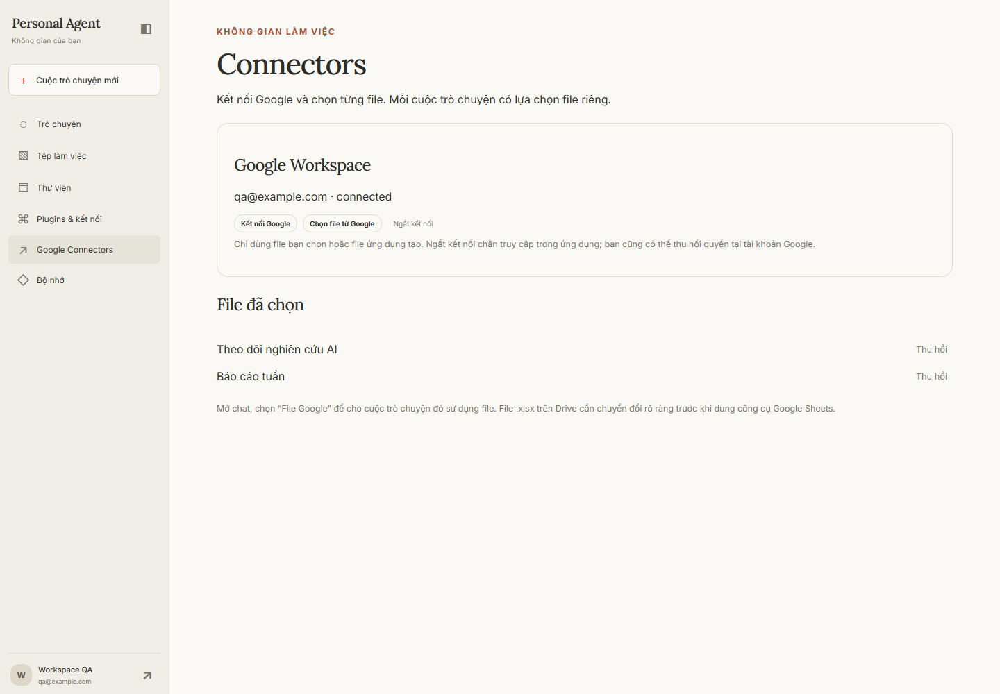
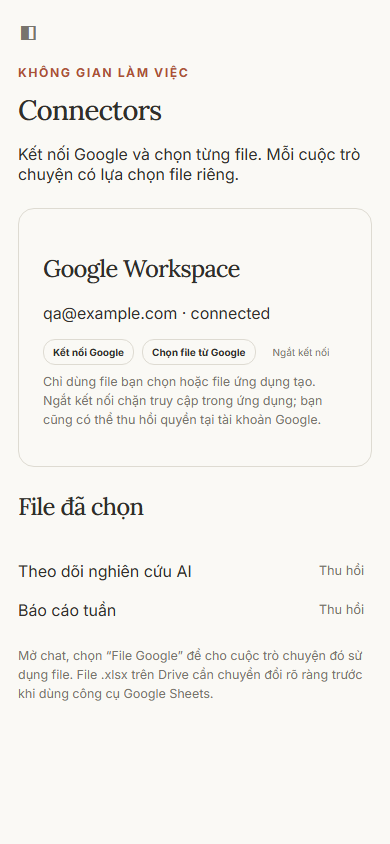

# Plan03 — Google Connectors, 2026-11-06

Triển khai trên `feat/workspace-google`, base `11b9632`, trong worktree riêng. Main, `.env`,
dịch vụ/database đang dùng và remote không thay đổi. Người dùng chọn triển khai/kiểm thử offline
trước vì chưa có OAuth Web Client hay file Google thử. **Live Google NOT RUN**; không coi fixture
là nghiệm thu live, chưa mở Plan04.

## Đã kiểm tra

- OAuth state/owner/TTL/replay, refresh đồng thời, invalid_grant/reconnect, độc lập keyring plugin.
- Picker/global grants/per-chat selection, ID/type/permission, revoke và account generations.
- Sheets RAW và công thức chủ đích, formatting, phân trang/range bounds, dedup cột chủ đích.
- Proposal bất biến/approval host, snapshot đổi, concurrent same-key, receipt replay,
  mất response và lỗi commit receipt; sent/unknown chặn cả mã gọi mới.
- Ba luồng qua queue/worker/graph/PostgreSQL checkpoints thật với fixture model: đọc/phân tích,
  search tool thật được gọi với nguồn fixture rồi append, đọc rồi update qua durable approval.
- Docs UTF-16/tab/revision, nhiều sửa không chồng lấn, bảo toàn bảng/phần không sửa, tạo Doc trắng,
  dùng tiếp file mới cùng run, không tạo lại khi mất response.
- Upload immutable XLSX/DOCX ở hai mode, byte hash/owner/work scope, receipt/unknown,
  Location giả không chuyển credentials, che upload session ID trong log.
- Catalog Google/Artifact và routing thực tế giữ prepare/search tools; Google schema allowance
  hữu hạn 16.000 tokens và tối thiểu 12 ứng viên khi bật flag, vẫn chịu trần context chung.
- `scripts.check_google_connector --offline`: **71 passed**, 92,40 giây. Không gọi Google thật,
  không tìm web thật, không gọi model trả phí. Tách schema DB theo test và dọn đúng schema đó.
- Ruff, syntax JS, `uv lock --check --offline`, Compose config và `alembic check` đạt;
  migration 0033 đã áp dụng riêng trên DB QA, không còn schema diff.

Hồi quy toàn project với broker loopback/Docker Artifacts: **1.266 passed, 1 skipped**,
1.161,32 giây. Skip duy nhất là quyền tạo symlink trên Windows; benchmark Excel và browser
Word/PDF đã chạy. Lượt đầu phát hiện ba lỗi ở cấu hình harness, đã sửa phạm vi format Word/PDF
và giữ MCP defaults rồi chạy lại toàn suite; không sửa production để làm test xanh.
Review độc lập đã kết thúc; bảy Important đã sửa và kiểm thử hồi quy, một Minor được ghi rõ bên dưới.

## UI offline

Ảnh dùng template, CSS và Inter/Lora đi kèm project, account/file giả; không phải ảnh Google live.
Đã xem cả hai cỡ, không cắt tiêu đề hoặc tràn ngang; sidebar mobile giữ đóng mặc định.

## Giới hạn nghiệm thu

Live OAuth/Picker, refresh token thật, dữ liệu Sheets/Docs, fidelity chuyển đổi và deployment callback
chưa được chứng minh. CLI `--live` chỉ in kế hoạch trên file đích đã chọn, không vượt chat approvals.
Giữ định dạng upload là gửi đúng bytes trong fixture; khả năng mở/chuyển đổi của Google phải kiểm riêng.
Sheets vẫn có race sau snapshot; Docs dùng requiredRevisionId. Unknown cần đối soát tin cậy,
chưa có UI/API để Agent tự gỡ. Docs chưa sửa ảnh/bảng/field; upload chưa chọn folder hay chia sẻ/xóa cloud.

Hướng dẫn đầy đủ: [manual](../manual-google-connectors.md).

## Review và lượt sửa cuối

Reviewer độc lập dùng fresh context, đọc toàn nhánh `11b9632..1473f6b`; không gọi Google/model thật.
Kết quả: 0 Critical, 7 Important, 1 Minor. Bảy Important được xác minh lại và sửa trong một lượt;
không yêu cầu reviewer đọc lại. Gate Google sau sửa: **71 passed, 92,40 giây**. Hồi quy toàn project
sau sửa: **1.266 passed, 1 skipped**, 1.161,32 giây; trước sửa là 1.245 passed/1 skipped.

| Finding | Hành vi được sửa và bằng chứng RED → GREEN |
| --- | --- |
| F1 — phản hồi hỏng | JSON hỏng và ValueRange không có envelope hợp lệ bị từ chối. Receipt Sheets/Docs thiếu dữ liệu bắt buộc giữ unknown và không gửi lại. 4 test RED ban đầu và 1 test Docs RED bổ sung; GREEN qua gate 71. ValueRange rỗng có range hợp lệ vẫn đọc được. |
| F2 — file vừa tạo | Receipt giữ grant/connection generations và MIME. Guard kiểm cả output cùng run, không hồi sinh quyền sau revoke/regrant. Ba test RED → GREEN: OperationJournal thật + crash trước checkpoint + graph resume; thu hồi trong khi đang đọc; phát lại creation sau cấp lại. Có thêm regression cho upload. |
| F3 — Docs suggestions | Yêu cầu SUGGESTIONS_INLINE; bỏ qua textRun có insertion/deletion/style suggestions và không cho sửa vùng đó. Ba biến thể RED → GREEN. |
| F4 — tab đích | Ghim sheetId và tên quoted từ prepare, chọn tab hiển thị đầu tiên cho range không tên tab. Reorder giữ đích; rename đòi duyệt lại trước sent. Hai test RED → GREEN. |
| F5 — format snapshot | Snapshot/before chứa đúng thuộc tính format bị ảnh hưởng, kiểm lại trước sent. Ba thay đổi ngoài: bold/background/numberFormat RED → GREEN. |
| F6 — format rỗng | Schema chặn empty/all-null format; compile request trong prepare và kiểm trước sent. Hai biến thể RED → GREEN, không tạo unknown giả. |
| F7 — gọi quyền lặp | Gom kiểm tra Google trong từng capability boundary, bulk local checks trước/sau provider. Test thực với 20 file/10 tools tái hiện 400 calls trước model qua hai boundary; sau sửa còn 40 (20/boundary). Chạy boundary mới vẫn gọi mới; revoke chặn trước provider/model. |

Test hồi quy mới: `tests/test_google_review.py` (21 cases). Các lỗi thiết lập probe ban đầu
(digest journal và selection regrant) được sửa trước khi xác nhận RED, không tính là bằng chứng lỗi.
Ruff toàn repo, định dạng các file thay đổi, Node syntax và diff check đạt. Full Docker regression
đạt sau lượt sửa, trước commit; không có live Google hoặc model trả phí.

### Deferred minors

- Xác nhận tạo file/upload hiện ghi “Google Drive (My Drive)” nhưng chưa hiện email/tên tài khoản
  đích trong immutable preview. Mô hình một kết nối/người dùng và kiểm generation vẫn áp dụng;
  cần bổ sung nhãn tài khoản ở một thay đổi UX sau, không nằm trong lượt sửa Important.

### Rulings I made — chronological record

1. normalize headings G1-G6 to Task 1-6 retaining labels, and allocate new migration 0033 after existing 0032 — required by task parser and the current applied schema — cost if wrong: no product change from headings; migration order must remain linear.

2. implement and prove offline without requiring account setup, record live checks NOT RUN until a user selects dedicated test files — plan explicitly permits missing-account reporting — cost if wrong: offline evidence cannot establish Google live acceptance or unlock Plan04.

3. use google-auth-oauthlib Flow for authorization URL/PKCE, fixed token endpoints through async HTTPX for exchange/refresh - avoids blocking requests transports and keeps response bounds/error sanitization identical to REST adapters; Google documents both library and direct endpoint flows - cost if wrong: token response/scope/expiry validation is maintained locally and covered by tests.

4. reconnect always revokes previous Google grants, including same-account reconnect, and requires explicit conversation re-selection - prevents old account/grant resurrection across generation changes - cost if wrong: users must pick and select files again after reconnect.

5. use a two-step immutable local proposal and exact host approval fingerprint, never a model approval boolean; all external writes retain existing approval policy - binds preview to pinned payload and permits durable replay checks - cost if wrong: append also requires an explicit approval step.

6. constrain explicit A1 ranges to 1000 rows/50 columns and read pages to 100 rows; preview truncation is labeled and full payload remains pinned - bounded observations and approvals - cost if wrong: large sheets need multiple calls; Sheets external edits can still race after final snapshot, no cross-service transaction is promised.

7. live CLI prints the exact selected-file test checklist and exits NOT RUN; actual writes must use authenticated chat previews/approvals - no standalone CLI approval bypass, and user requested offline-only - cost if wrong: live acceptance requires operator-guided chat and cannot be inferred from CLI success.

8. unresolved sent/unknown writes fence new writes to the same target (new-file operations fence that connection) until trusted reconciliation - prevents model-generated new IDs bypassing no-blind-retry policy - cost if wrong: operators must resolve uncertain outcomes before using that target again.

9. create blank native Docs in one journaled RPC, then add text through a separate prepared/approved edit - avoids a hidden create+populate partial transaction - cost if wrong: two approval steps for a populated new document.

10. Docs edits use original UTF-16 coordinates within one returned text run, preserve paragraph terminators, reject overlaps/unsupported components, and send requiredRevisionId - preserves non-text structures and catches provider races - cost if wrong: cross-run/paragraph replacements need several operations; non-text editing stays unsupported.

11. Google-enabled routed selection permits at least 12 loaded candidates while retaining schema/context ceilings - default four silently omitted required prepare/search tools in actual routing probes - cost if wrong: more authorized tool schemas can enter a turn; no run token budget changed.

12. export uses a local proposal tool plus approved commit, pins ArtifactVersion hash/size/mode and reads bounded owned bytes once for the RPC; resumable session never leaves trusted memory - extends shared approval/journal semantics to upload/conversion - cost if wrong: full uploads are capped at 20 MiB and a failed session is reconciled rather than automatically resumed.

13. Google-enabled schema allowance is 16000 tokens after actual full catalog fit failed at 10000; still clamped by context allocation and existing routing catalog policies - permits Artifact/Sheets/Docs/Drive together - cost if wrong: larger schema input, without changing overall run token policy.

14. Live OAuth/Picker, refresh tokens, callback deployment and conversion fidelity remain NOT RUN — user explicitly chose offline-only implementation; fixtures cannot establish provider acceptance — cost if wrong: real consent/deployment/conversion issues remain possible and Plan04 stays gated.

15. Sheets edits after the last snapshot check remain a documented race — Google Sheets offers no transaction spanning our database and the provider; this pass fixes changes before the check — cost if wrong: a concurrent last-moment edit may still be overwritten.

16. Docs tables/images/footnotes and other non-text edits, advanced charts, destination folders, sharing/ownership/deletion/Apps Script remain deferred — approved first scope is text and selected files — cost if wrong: those requests must be refused or handled later.

17. Genuine uncertain uploads/writes keep trusted manual reconciliation and no automatic resume or Agent unlock — preserves no-blind-retry semantics for external side effects — cost if wrong: operators must reconcile a target before further writes.

18. No whole-Drive discovery or dedup beyond the supplied bounded range — user selected individual-file access and explicit bounded observations — cost if wrong: duplicates outside that range are not detected.

19. Shared Google authority is deduplicated only inside each graph validation boundary, with fresh bulk local checks before/after live metadata and target-specific service authorization for RPCs — preserves all selected/created observations against revocation without tool-count multiplication — cost if wrong: each boundary still checks every in-scope file, so larger selections use proportionally more quota; no cross-boundary TTL cache.

20. All Sheets write proposals pin canonical quoted tab name plus stable sheetId; renaming requires a new approval while reordering preserves identity — avoids silently retargeting unqualified ranges — cost if wrong: users must repeat approval after a harmless rename.
