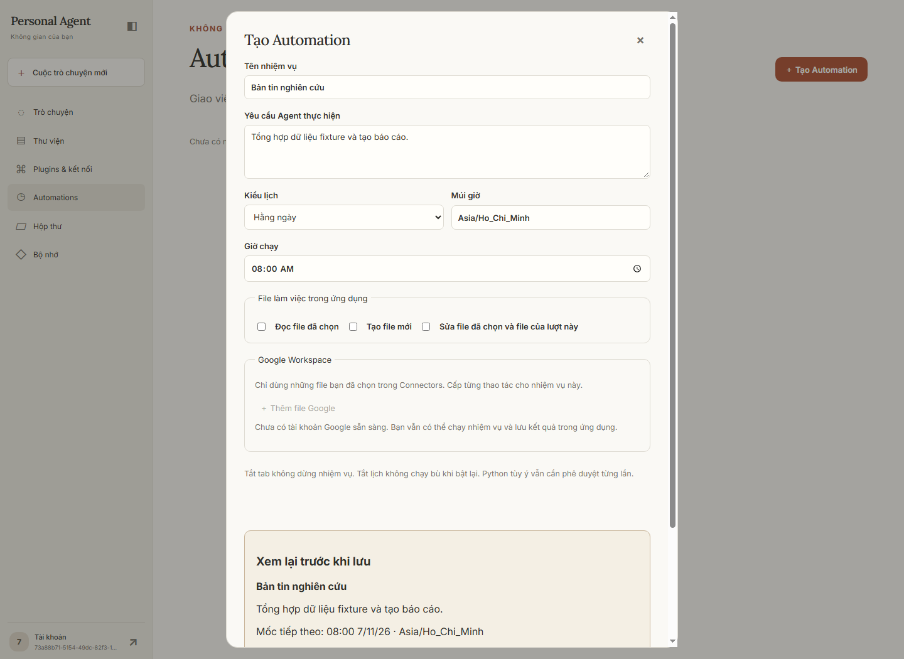
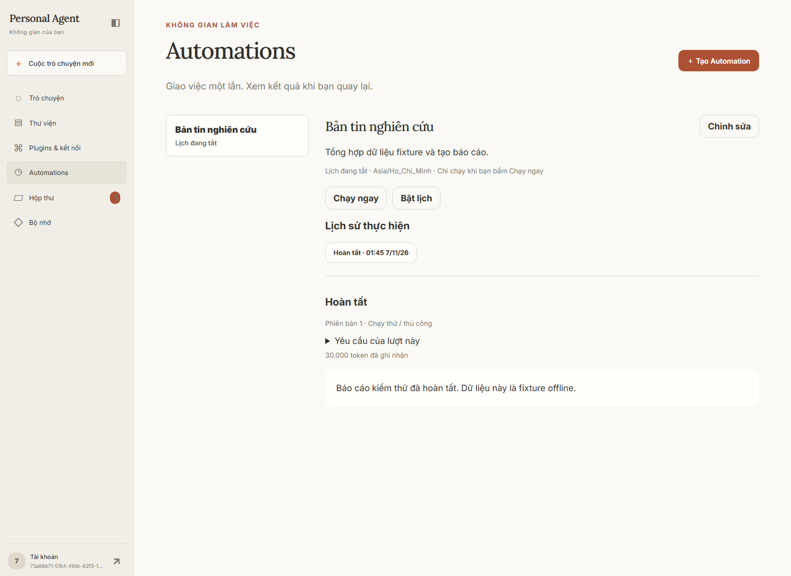
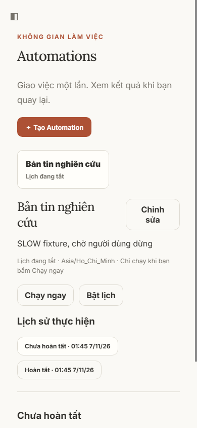

# Plan04 — Scheduled Automations

Source triển khai `4af8135` từ branch `feat/workspace-automations`, base `df49358`.
Đã gộp local vào main; xem [biên bản gộp và hậu kiểm](2026-11-07-automations-main-merge.md).
Chưa push, đổi `.env`, migrate database người dùng hoặc bật tính năng trên dữ liệu thật.

## Phạm vi

- Automation draft/revision, từng file/tab/vùng/quyền, lịch một lần/ngày/tuần theo timezone.
- Scheduler riêng phát hành job vào queue PostgreSQL; dùng chung Agent graph, worker,
  checkpoint, journal, Google/Artifact tool executor với chat.
- Run now, stop lượt hiện tại, pause lịch (giữ hoặc dừng lượt), bật lại không chạy bù.
- Một slot active, tính cả chờ duyệt và đối soát; missed/overlap được lưu.
- Automations/Inbox, usage thực tế, kết quả/file/link và duyệt sau reload. Preview mở khi bấm.
- Aggregate token/bước/thời gian của automation không có trần; chat giữ policy hữu hạn.
  Context/output mỗi call, rate limit, RPC timeout, sandbox/quyền/approval vẫn áp dụng.

Không bao gồm condition triggers/webhook/polling, ảnh/OCR hay workflow builder.

## Môi trường và bằng chứng

Chỉ dùng container PostgreSQL QA của task, loopback `65406`, database
`workspace_automation_test`. Từng test Google/automation tạo/drop schema ngẫu nhiên của
chính nó; không dùng database người dùng. HTTP Google, web và model đều là fixture.

- A1–A6: gate riêng từng task và hồi quy toàn bộ; A6 **1.272 passed, 59 skipped**.
- Gate automation CLI offline: **109 passed**, 169,06 giây. Kiểm thử bổ sung stop trong
  RPC đã ghi remote: **1 passed**; GoogleMutation giữ `unknown`, đúng một lần ghi.
- Hai scheduler process phát hành đúng một tick/job; hai worker claim/recovery từ DB thật.
- Worker child bị `os._exit(91)` sau commit Google receipt; restart từ PostgreSQL checkpoint
  tiếp tục tổng hợp, provider giữ đúng một lần append và không gọi lại model đã hoàn tất.
- Mất response sau Google ghi: dừng ngay trước model/tool tiếp theo, giữ active slot
  `needs_reconciliation`; đóng không phát lại giữ receipt/journal và không ghi lần hai.
- Waiting approval sau hai ngày vẫn tải lại và duyệt được; mốc lịch mới bị skipped_overlap.
  Chat giữ timeout hữu hạn. Pause/admission race dùng PostgreSQL locks.
- Browser Chrome thật: tạo/review/lưu/chạy/bật/sửa/pause/stop/đối soát/inbox/read; đóng tab
  khi worker chạy, reload xem kết quả; desktop/mobile không tràn ngang, preview theo click.
- Migration 0035→0036 trên QA: upgrade thành công, `alembic check` không có drift.
- Ruff, Node syntax và Compose profile validation đã chạy; gate cuối sẽ ghi bên dưới.

Hồi quy toàn bộ khi bật Docker Artifacts: **1.336 passed, 8 failed, 1 skipped**,
1.079,27 giây. Tất cả ca Artifact/Docker đạt; skip là quyền symlink Windows.
Tám lỗi đến từ harness mở rộng gate Artifact ra toàn suite: sáu lỗi console cp1252
khi in tiếng Việt với `-s`, hai lỗi vì gate ép `MCP_DEMO_ENABLED=false` trong khi test
đang kiểm tra default cũ. Bật UTF-8 và giữ default MCP cho toàn suite, chạy lại nhóm
liên quan đạt **10 passed / 50 deselected**, không đổi code ứng dụng để làm test xanh.
Toàn suite tiêu chuẩn với môi trường đúng: **1.286 passed / 59 skipped**, 283,14 giây;
59 skip là các gate tùy điều kiện không bật trong lượt chuẩn, đã có bằng chứng Docker phía trên.
Cảnh báo pytest `cache_dir` do chủ động tắt cache provider; không phải lỗi ứng dụng.
Review độc lập toàn nhánh đã hoàn tất trên `df49358..a966dff`: bảy Important,
không có Critical được xác lập. Lượt sửa và gate cuối được ghi tại
[biên bản review](2026-11-07-automations-review.md); không thực hiện re-review.

Sau lượt sửa review, đợt mở rộng toàn bộ với Docker kết thúc **1.357 passed / 5 failed /
1 Windows symlink skip** (2.535,27 giây), không được ghi là toàn Docker đã xanh.
Ba lỗi đồng bộ/thời gian trong test được kiểm tra lại với readiness rõ ràng: nhóm scratch,
timeout và duyệt qua đêm đạt **9 passed** (30,07 giây), giữ nguyên policy sản phẩm.
Benchmark workbook 10.000×12 và browser Document chạy lại riêng đạt **2 passed**
(350,84 giây), không thay giới hạn sandbox; chi tiết lỗi và kết quả được giữ trong biên bản review.
Gate cuối toàn suite tiêu chuẩn trên source hiện tại: **1.304 passed / 59 conditional skips**,
373,30 giây, exit 0. Bao gồm cả 17 ca hồi quy review và ba biến thể ngắt/khôi phục tiến trình thật.
Usage đối chiếu đúng journal: hai ca thành công 50.000 token, ca mất response 40.000 token
đã biết cùng cờ unknown; mỗi ca đúng một append. Cả bảy Important đã sửa, không re-review.
Một Minor phân trang lịch sử/Inbox trên 100 mục còn hoãn; lượt active vẫn được ghim để thao tác.

## Các lỗi được phát hiện qua nghiệm thu

1. Approval automation dùng timeout chat 5 phút: test tái hiện RED, đổi expiry nullable
   chỉ cho AutomationRun owner/context hợp lệ, GREEN. Migration 0036; không nới TTL proposal Google.
2. Google unknown outcome chưa dừng vòng Agent: test RED gọi model ba lần; GREEN dừng sau
   một lần và không kết thúc operation journal thành completed.
3. Recorder mất map ToolCall khi worker restart: hard-kill test RED `KeyError (3, call-2)`;
   khôi phục đúng call từ DB theo run/conversation/step/provider ID/name/arguments, GREEN.
   Test recorder mới cũng bắt RED cho tool_started thiếu step map và đã được sửa.

## Giao diện

## Chưa nghiệm thu thật

**Google OAuth/Sheets/Docs thật: NOT RUN. Model trả phí: NOT RUN.** User chọn cấu hình
Google sau và gom nghiệm thu toàn luồng ở cuối. Không coi fixture là bằng chứng cloud.
Chưa nghiệm thu tải phân tán lớn. Chưa bật feature hoặc migrate database đang sử dụng.

Hướng dẫn bước tiếp theo: [Automations](../manual-automations.md) và
[Google Connectors](../manual-google-connectors.md). Dùng file thử được chọn riêng;
kiểm tra nội dung đích thật trước khi bật lịch thường xuyên.

## Rulings và review

Các quyết định và chi phí được giữ theo thứ tự trong phần sau. Các mục reviewer
không đánh giá và quyết định cuối được giữ tại [biên bản review](2026-11-07-automations-review.md).

1. Làm Plan04 offline trước, dời Google thật đến nghiệm thu chung theo lựa chọn user;
   chi phí: hành vi cloud chưa được xác minh trước gate đó.
2. Chuẩn hóa tiêu đề task cho script và dùng migration 0034 sau head Google 0033;
   chi phí: giữ nhãn A1–A7 để các tham chiếu cũ vẫn tra cứu được.
3. Dùng `agent_run_handler`/stream hiện có làm executor headless, tách `run_input` dùng chung;
   chi phí: orchestration vẫn phụ thuộc module route cho đến khi có nhu cầu refactor riêng.
4. Thêm migration 0035 lưu Sheet tab ID, không sửa migration đã áp dụng;
   chi phí: thêm migration và yêu cầu chọn đúng tab identity.
5. Quyền append là vùng tìm bảng theo native Google append, quyền update/format giới hạn ô;
   chi phí: không hứa vùng vật lý cuối cùng của append cố định khi có chỉnh sửa đồng thời bên ngoài.
6. `create_doc` bao gồm đọc/soạn Doc mới do chính lượt đó tạo, ghim bằng receipt/generation;
   chi phí: lượt được tự chỉnh nội dung đầu ra mới, không tự được sửa Doc có sẵn.
7. Chặn xóa conversation thực thi qua chat chung để giữ journal và unknown fence;
   chi phí: audit history được giữ đến khi có retention policy riêng.
8. Dùng SSE run hiện có và poll Inbox DB mỗi 10 giây;
   chi phí: badge ngoài chi tiết run có thể chậm tối đa khoảng 10 giây.
9. Approval automation hợp lệ dùng expiry nullable qua migration 0036, giữ timeout chat/TTL Google;
   chi phí: giữ một worker và active slot đến khi owner quyết định/dừng, downgrade phải từ chối
   các approval không expiry còn lưu.
