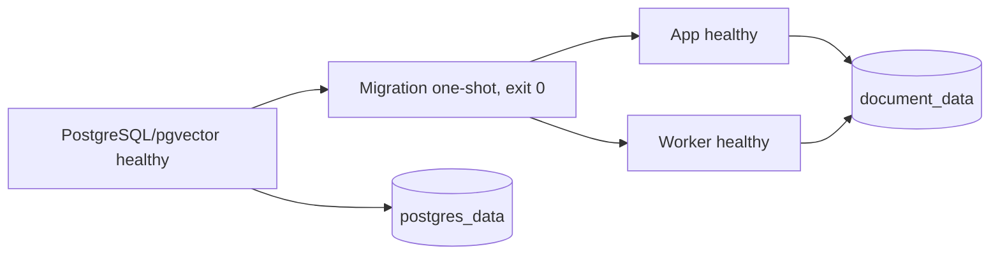

# Docker dev — app, worker và PostgreSQL/pgvector

Yêu cầu máy mới: Docker Engine/Desktop chạy Linux containers, Docker Compose v2.24 trở lên,
source project và kết nối mạng để tải image/dependency. Không cần Python, `.venv`, PostgreSQL
hoặc API key trên host để khởi động và chạy kiểm tra offline.

## Khởi động

Từ thư mục gốc project, tạo config Docker riêng:

```powershell
Copy-Item .env.docker.example .env.docker
docker compose --env-file .env.docker up -d --build --wait --wait-timeout 180
docker compose --env-file .env.docker ps -a
```

Chỉ copy khi `.env.docker` chưa có để giữ cấu hình đã điền. Mở `http://127.0.0.1:8000`.
Nếu cổng bận, đổi `DEV_HTTP_PORT` trong `.env.docker`. Config này dùng các biến `DEV_*`,
không lấy `DB_*`/`AUTH_*`/API key của `.env` đang dùng cho ứng dụng trên Windows.

Để dùng DeepSeek, đặt `DEV_DEEPSEEK_API_KEY` rồi recreate app bằng lệnh `up -d` như trên.
Không có key, auth/UI/memory API và MCP vẫn khởi động; gửi chat tới provider sẽ báo chưa cấu hình.
`DEV_MEMORY_EXTRACTION_ENABLED` mặc định false cho startup offline; có thể bật cùng key hợp lệ.
Không truyền key bằng build arg hoặc thêm `.env` vào image. Các mật khẩu mẫu chỉ dành cho dev local.

## Service và thứ tự khởi động



- `postgres`: `pgvector/pgvector:0.8.7-pg17-bookworm`; không publish cổng DB ra host.
  `pg_isready` kiểm tra TCP của server cuối, tránh coi temporary init server là ready.
- `migrate`: image riêng từ target app; chạy `scripts.migrate_database` rồi thoát.
  Lần lượt tạo extension `vector`, Alembic upgrade head và setup schema checkpoint LangGraph.
  `restart: no`; app/worker phụ thuộc `service_completed_successfully`.
- `app`: image target `app`, UID/GID 10001, `uvicorn`, cổng 8000 trong container;
  chỉ bind host `127.0.0.1:${DEV_HTTP_PORT}`. Healthcheck gọi `/health/ready` có kiểm tra DB.
- `worker`: image target `worker`, UID/GID 10001, process queue riêng; không publish cổng.
  Healthcheck yêu cầu heartbeat còn mới của đúng queue, được cập nhật bởi loop xử lý thật,
  kể cả lúc đang chạy job. SIGTERM/SIGINT yêu cầu drain rồi đóng DB pool.

App/worker không chạy Alembic hoặc tự setup checkpoint schema trong Docker. Biến
`LANGGRAPH_CHECKPOINT_AUTO_SETUP=false` áp dụng ở runtime, giữ mặc định true cho luồng chạy
host hiện có. Migration one-shot idempotent: có thể chạy lại khi restart/update stack, không phải
một daemon, cũng không phải job chạy mỗi request.

Image dùng hai stage chung cho dependency/source và hai target app/worker. Compose build migration
bằng target app nhưng xuất tag riêng để các exporter chạy song song không ghi cùng tag.
Dependency stage đọc requirements từ `pyproject.toml`; Day 79 sẽ bổ sung lockfile tái lập.
Package source nằm tại `/app` để đường dẫn templates/static/skills/migrations hiện tại hoạt động.

## Volume và môi trường thực thi

- `postgres_data`: PG data, users/chat/memory/jobs/checkpoint; chỉ postgres mount volume này.
- `document_data`: volume riêng tại `/app/data/documents`, app/worker cùng UID để đọc/ghi.
  Đây là phần chuẩn bị storage; chưa triển khai upload/RAG của M3.
- Root filesystem app/worker read-only; `/tmp` là tmpfs riêng, có quota 64 MiB.
  Không bind mount source, host `.env`, `.venv` hoặc Docker socket vào runtime.
- `.dockerignore` dùng allow-list; build context chỉ nhận code/assets cần thiết, không nhận
  secret, báo cáo, backup hay PDF local. Dockerfile không copy toàn bộ thư mục project.
- Python sandbox tắt trong profile này, tool `run_python_code` không được đăng ký.
  Tích hợp runner Docker riêng tại M6; MCP demo/approval/quota/Skills hiện tại vẫn giữ policy.
- Các feature V2 mặc định tắt. Profile này chưa triển khai Redis, plugin platform hoặc planner.

Không đặt `container_name` hoặc tên volume cố định. `--project-name` tạo namespace khác cho
container/network/volume, dùng được cho nhiều lần thử mà không đụng PostgreSQL trên Windows.
Thay `DEV_DB_*` sau khi đã tạo volume không tự đổi role/password/database bên trong PostgreSQL;
cần migration/quản lý DB tương ứng hoặc dùng một project mới cho dữ liệu dev mới.

## Kiểm tra startup offline

Sau khi `up --wait` thành công:

```powershell
docker compose --env-file .env.docker exec -T app python -m scripts.run_e2e_smoke --base-url http://app:8000
docker compose --env-file .env.docker exec -T app python -m scripts.check_compose_runtime
docker compose --env-file .env.docker exec -T app python -m scripts.check_langgraph_checkpoint
docker compose --env-file .env.docker exec -T app alembic check
```

E2E tạo hai user tạm, kiểm tra health/auth/conversation/isolation rồi cleanup. Runtime probe chỉ
chấp nhận DB Compose development chưa có user; kiểm tra vector SQL, migration, worker nhận job
thật, LangGraph → MCP calculate → final và checkpoint thật bằng model fixture (không gọi provider).
Probe dọn job/thread thử và để lại `/app/data/documents/.compose-startup-probe.txt` nhằm kiểm tra
volume sau recreate. Chỉ xóa file probe này khi đã kiểm tra xong. Đây không phải live LLM quality eval.

Để kiểm tra build sạch và database mới, dùng project name mới, xác nhận chưa có volume thuộc
project đó, rồi `build --pull --no-cache` và `up --wait`. Tên volume phải khác stack đã có.
Lưu image ID, package version, log migration và bằng chứng restart/persistence trong báo cáo.
Thử này mô phỏng checkout mới trên máy chỉ có Docker; không thay thế kiểm thử trên mọi OS/CPU.

## Restart, migration và dừng

```powershell
docker compose --env-file .env.docker logs --tail 100 migrate app worker
docker compose --env-file .env.docker up -d --build --wait --wait-timeout 180
docker compose --env-file .env.docker down
```

`down` giữ các named volume; lần `up` sau dùng lại dữ liệu và migration chạy idempotent.
Không chạy `down --volumes` cho stack còn dữ liệu cần giữ. Kiểm tra trước project name và backup
nếu muốn xóa volume dev. Không restore backup host vào stack test trong quá trình nghiệm thu startup.

Nếu migration exit khác 0, xem log `migrate` và xử lý nguyên nhân; app/worker chưa được phép khởi động.
Nếu worker unhealthy, kiểm tra process, DB/queue, heartbeat và polling interval. `max_age` phải lớn hơn
worker/control poll; giá trị rỗng `BACKGROUND_WORKER_HEARTBEAT_PATH` ở host tương đương tắt probe file.

Nguồn đối chiếu: [Docker Compose startup order](https://docs.docker.com/compose/how-tos/startup-order/),
[Compose service reference](https://docs.docker.com/reference/compose-file/services/),
[pgvector Docker images](https://github.com/pgvector/pgvector#docker).
