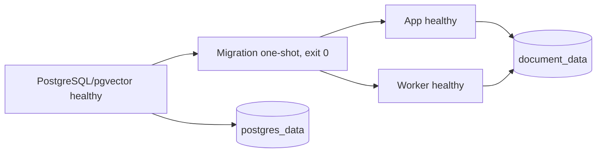

# Docker dev — app, worker và PostgreSQL/pgvector

Yêu cầu máy mới: Docker Engine/Desktop chạy Linux containers, Docker Compose v2.24 trở lên,
source project và kết nối mạng để tải image/dependency. Không cần Python, `.venv`, PostgreSQL
hoặc API key trên host để khởi động và chạy kiểm tra offline.

## Khởi động

Từ thư mục gốc project, tạo config Docker riêng:

```powershell
Copy-Item .env.docker.example .env.docker
docker compose --env-file .env.docker up -d --build --wait --wait-timeout 180
docker compose --env-file .env.docker ps -a
```

Chỉ copy khi `.env.docker` chưa có để giữ cấu hình đã điền. Mở `http://127.0.0.1:8000`.
Nếu cổng bận, đổi `DEV_HTTP_PORT` trong `.env.docker`. Config này dùng các biến `DEV_*`,
không lấy `DB_*`/`AUTH_*`/API key của `.env` đang dùng cho ứng dụng trên Windows.

Để dùng DeepSeek, đặt `DEV_DEEPSEEK_API_KEY` rồi recreate app bằng lệnh `up -d` như trên.
Không có key, auth/UI/memory API và MCP vẫn khởi động; gửi chat tới provider sẽ báo chưa cấu hình.
`DEV_MEMORY_EXTRACTION_ENABLED` mặc định false cho startup offline; có thể bật cùng key hợp lệ.
Không truyền key bằng build arg hoặc thêm `.env` vào image. Các mật khẩu mẫu chỉ dành cho dev local.

Để dùng tool `search_web`, đặt `DEV_OPENROUTER_API_KEY` và `DEV_WEB_SEARCH_ENABLED=true` trong
`.env.docker`, rồi recreate app. Model riêng mặc định `DEV_WEB_SEARCH_MODEL=openai/gpt-5.4-mini`,
timeout60 giây/output2000 token. Tool kiểm endpoint hỗ trợ native search và chỉ chọn provider OpenAI;
token model và chi phí search dùng số dư OpenRouter. Chưa chạy kiểm live trong Docker ở bước này;
kiểm thật đã chạy qua backend/API trên Windows. Host Windows dùng các tên tương ứng không có `DEV_`.

## Service và thứ tự khởi động



- `postgres`: `pgvector/pgvector:0.8.7-pg17-bookworm`; không publish cổng DB ra host.
  `pg_isready` kiểm tra TCP của server cuối, tránh coi temporary init server là ready.
- `migrate`: image riêng từ target migrate/base dependency; chạy `scripts.migrate_database` rồi thoát.
  Lần lượt tạo extension `vector`, Alembic upgrade head và setup schema checkpoint LangGraph.
  `restart: no`; app/worker phụ thuộc `service_completed_successfully`.
- `app`: image target `app`, UID/GID 10001, `uvicorn`, cổng 8000 trong container;
  chỉ bind host `127.0.0.1:${DEV_HTTP_PORT}`. Healthcheck gọi `/health/ready` có kiểm tra DB.
- `worker`: image target `worker`, UID/GID 10001, process queue riêng; không publish cổng.
  Healthcheck yêu cầu heartbeat còn mới của đúng queue, được cập nhật bởi loop xử lý thật,
  kể cả lúc đang chạy job. SIGTERM/SIGINT yêu cầu drain rồi đóng DB pool.

App/worker không chạy Alembic hoặc tự setup checkpoint schema trong Docker. Biến
`LANGGRAPH_CHECKPOINT_AUTO_SETUP=false` áp dụng ở runtime, giữ mặc định true cho luồng chạy
host hiện có. Migration one-shot idempotent: có thể chạy lại khi restart/update stack, không phải
một daemon, cũng không phải job chạy mỗi request.

Image dùng hai stage chung cho dependency/source và hai target app/worker. Compose build migration
bằng target app nhưng xuất tag riêng để các exporter chạy song song không ghi cùng tag.
Dependency stage dùng uv 0.13.1 và `uv sync --locked --no-dev --no-install-project --no-build`
từ `pyproject.toml`/`uv.lock`; không resolve lại version khi build. Python/uv/PostgreSQL được pin
theo digest. Target `test` riêng thêm extra dev và fixture, không đưa pytest/ruff vào runtime.
Quy trình cập nhật lock và CI: [Dependency/CI](../../../docs/DEPENDENCIES_AND_CI.md).
Package source nằm tại `/app` để đường dẫn templates/static/skills/migrations hiện tại hoạt động.

## Volume và môi trường thực thi

- `postgres_data`: PG data, users/chat/memory/jobs/checkpoint; chỉ postgres mount volume này.
- `document_data`: volume riêng tại `/app/data/documents`, app/worker cùng UID để đọc/ghi.
  Lưu upload/bản trích text riêng theo user và vùng tạm ingestion, không public qua static.
- `document_model_cache`: app/worker mount tại `/app/data/models`; cache F2LLM, Qwen reranker/tokenizer và model
  layout/table của Docling. Worker cài extra `ingestion` (gồm embedding/PyTorch CPU) và LibreOffice
  Writer; app chỉ cài extra `embedding`, migrate giữ base dependency. Build không tải model weights;
  lần xử lý/tìm kiếm đầu cần mạng để điền cache. Model embedding chạy trong subprocess được tái sử dụng,
  mặc định batch 4, CPU float32, theo dõi RSS/timeout, không load model cho mỗi batch/query.
  Worker công bố version ready sau khi đủ vector/FTS; M3.7 đã nối nhánh document_qa có citation.
  Hybrid dùng một query sau rewrite: 20 dense + 20 lexical → RRF Top10. Fast mặc định giữ RRF;
  Deep rerank tối đa10 đoạn bằng Qwen3-Reranker-0.6B. Không phân rã query hoặc Round-Robin.
  Reranker có process/cache riêng, CPU float32, mặc định batch 1, 4 GiB RSS, 600 giây/request;
  embedding/reranker có thể cùng ở RAM nên giới hạn RSS từng process không phải RAM tổng app.
  `DOCUMENT_RERANKER_REVISION=main` resolve về commit lúc load; pin commit nếu cần tái lập/offline.
  `POST /api/documents/search` mặc định `mode=hybrid`; `dense`/`lexical` vẫn là baseline độc lập.
  Hybrid lấy scope bằng `conversation_id` hoặc `document_ids`, chọn tối đa10 nguồn theo thứ hạng,
  bỏ nguyên chunk vượt `CONTEXT_RAG_TOKEN_BUDGET` (mặc định/max8000, gồm metadata). Tổng
  `CONTEXT_MAX_INPUT_TOKENS` mặc định36000; deployment có override cần đồng bộ cả hai.
  `limit` chỉ áp dụng cho baseline dense/lexical; hybrid cố định top-k. Không cần re-index.
  Có history của hội thoại thì gọi model chat một lần để rewrite; chỉ truyền tối đa 8 message,
  budget history 2.000 token ước lượng và metadata file, không gửi toàn bộ tài liệu. Không history
  thì bỏ rewrite. Response chứa query rewrite, usage/latency, profile reranker và evidence budget.
  Token rewrite báo về được cộng quota hiện có, kể cả output lỗi; API search không tạo message/run.
  M3.7 lưu trace vào agent_runs.rag_trace (migration 0027), bind citation vào message/version/chunk
  và cho phép mở nguồn từ chat, gồm cả khi tải lại hội thoại. API nguồn kiểm owner/private-no-store;
  bỏ chọn file không xóa citation, xóa file thư viện thì không đọc nguồn đó được nữa.
  Luồng chat cần DEV_V2_ENABLED=true, DEV_V2_ROUTING_ENABLED=true, DEV_V2_RAG_ENABLED=true,
  JEV active và key provider hợp lệ. Các cờ vẫn mặc định false; không tự bật khi deploy.
  QA lập tối đa3 câu hỏi con, dùng hybrid cho từng ý. Tóm tắt toàn file xử lý mọi chunk (tối đa64),
  ghi notes theo batch/thu gọn khi cần; vượt giới hạn thì báo rõ, không tự đổi thành tóm tắt top-k.
  QA dùng AGENT_MAX_STEPS/TOTAL_TOKENS/DURATION_SECONDS hiện có (mặc định8/20.000/120 giây).
  Khi cache model còn lạnh hoặc tài liệu dài, giới hạn thời gian có thể cần tăng trong cấu hình
  host trước đợt test; chưa có số đo runtime để chọn giá trị tối ưu. QA lỗi cần gửi lại câu hỏi,
  chưa resume từ checkpoint. Câu trả lời phát sau khi kiểm JSON/nhãn nguồn, không phát JSON thô.
  Hướng dẫn scoring: [Qwen model card](https://huggingface.co/Qwen/Qwen3-Reranker-0.6B).
  M3.8 có nút Xử lý lại trong thư viện và POST `/api/documents/{id}/reindex`
  với `expected_version_id`. Re-index tạo generation mới từ file gốc đã lưu, dùng cấu hình pipeline
  hiện tại; bản đang active vẫn dùng được đến khi bản mới publish. Thử lại tiếp tục generation
  chưa publish, Dừng xử lý không hủy bản active cũ. Không cần migration mới ngoài head0027.
  File gốc được dùng chung giữa generation cùng document, quota tính một lần theo storage key.
  Parsed artifact/chunk/vector cũ còn giữ để citation lịch sử trỏ đúng phiên bản; xóa file thư viện
  thu hồi truy cập ngay và cleanup toàn bộ generation sau khi ingestion dừng. Library cho yêu cầu
  xóa lại nếu cleanup lỗi; quota chỉ giải phóng sau khi worker dọn xong metadata.
  Cross-tab mutation gửi UUID/type qua BroadcastChannel; scope có polling/visibility refresh và
  API nguồn kiểm quyền mỗi lần mở. Không xóa model weights cache khi xóa tài liệu.
- Root filesystem app/worker read-only; `/tmp` là tmpfs riêng, có quota 64 MiB.
  Không bind mount source, host `.env`, `.venv` hoặc Docker socket vào runtime.
- `.dockerignore` dùng allow-list; build context chỉ nhận code/assets cần thiết, không nhận
  secret, báo cáo, backup hay PDF local. Dockerfile không copy toàn bộ thư mục project.
- Python sandbox tắt trong profile này, tool `run_python_code` không được đăng ký.
  Tích hợp runner Docker riêng tại M6; MCP demo/approval/quota/Skills hiện tại vẫn giữ policy.
- Các feature V2 mặc định tắt. Profile này chưa triển khai Redis, plugin platform hoặc planner.

Không đặt `container_name` hoặc tên volume cố định. `--project-name` tạo namespace khác cho
container/network/volume, dùng được cho nhiều lần thử mà không đụng PostgreSQL trên Windows.
Thay `DEV_DB_*` sau khi đã tạo volume không tự đổi role/password/database bên trong PostgreSQL;
cần migration/quản lý DB tương ứng hoặc dùng một project mới cho dữ liệu dev mới.

Nếu chạy Python trực tiếp trên Windows, cài dependency worker bằng
`.tools\uv\bin\uv.exe sync --locked --extra dev --extra ingestion`, cài LibreOffice Writer riêng
và đặt `DOCUMENT_LIBREOFFICE_PATH=C:/Program Files/LibreOffice/program/soffice.com` nếu chưa có
`soffice` trong PATH. Chạy worker bằng `.venv\Scripts\python.exe -m scripts.run_background_worker`.
Các giá trị quota/timeout/bộ nhớ/page/chunk và cache model có trong `.env.example`; không đưa secret
DB/mail/provider vào tiến trình parser. Parser chạy tách process, bị dừng khi timeout/vượt RSS/hủy;
đây không phải sandbox hệ điều hành để thực thi tài liệu tùy ý. OCR tắt.

Web native Windows chạy một worker, không dùng `--reload`:

```powershell
.venv\Scripts\python.exe -m uvicorn backend.main:app --host 127.0.0.1 --port 8000
```

Uvicorn chọn SelectorEventLoop trên Windows khi reload/nhiều worker, không hỗ trợ asyncio
subprocess mà embedding/reranker cần. Chế độ một worker không reload dùng ProactorEventLoop.
Khi sửa code, Ctrl+C rồi chạy lại web; worker tài liệu là tiến trình riêng. Quy tắc này dành
cho Windows native, không thay cấu hình Docker/Linux.

## Kiểm tra startup offline

Sau khi `up --wait` thành công:

```powershell
docker compose --env-file .env.docker exec -T app python -m scripts.run_e2e_smoke --base-url http://app:8000
docker compose --env-file .env.docker exec -T app python -m scripts.check_compose_runtime
docker compose --env-file .env.docker exec -T app python -m scripts.check_langgraph_checkpoint
docker compose --env-file .env.docker exec -T app alembic check
```

E2E tạo hai user tạm, kiểm tra health/auth/conversation/isolation rồi cleanup. Runtime probe chỉ
chấp nhận DB Compose development chưa có user; kiểm tra vector SQL, migration, worker nhận job
thật, LangGraph → MCP calculate → final và checkpoint thật bằng model fixture (không gọi provider).
Probe dọn job/thread thử và để lại `/app/data/documents/.compose-startup-probe.txt` nhằm kiểm tra
volume sau recreate. Chỉ xóa file probe này khi đã kiểm tra xong. Đây không phải live LLM quality eval.

Để kiểm tra build sạch và database mới, dùng project name mới, xác nhận chưa có volume thuộc
project đó, rồi `build --pull --no-cache` và `up --wait`. Tên volume phải khác stack đã có.
Lưu image ID, package version, log migration và bằng chứng restart/persistence trong báo cáo.
Thử này mô phỏng checkout mới trên máy chỉ có Docker; không thay thế kiểm thử trên mọi OS/CPU.

## Restart, migration và dừng

Ngày 81: migration head `20261018_0023` thêm plugin/grant/connection/reference và lịch sử catalog.
API mới mặc định tắt. Có thể bật `DEV_V2_ENABLED=true` và `DEV_V2_PLUGINS_ENABLED=true` trong
shell dev hoặc `.env.docker`, rồi recreate app/worker. Xem [luồng API](../../../docs/plugins/API.md).
`runtime_connected=false`: cấu hình control API chưa mở thêm MCP transport.

Ngày 82: image đóng gói `plugins/stdio/servers.json`. `DEV_MCP_STDIO_CONFIG_PATH` chọn profile file
trong container; file ngoài image cần mount read-only. Manager giữ demo alias V1, cô lập lỗi từng
stdio server; admin kiểm tra `/api/admin/mcp-runtime`. Gate Compose chạy probe nhiều process thật
dưới UID 10001/root read-only. Xem [runtime guide](../../../docs/plugins/STDIO_RUNTIME.md).

Ngày 83: image có `plugins/http/servers.json`, mặc định không có endpoint. Compose nhận
`DEV_MCP_HTTP_CONFIG_PATH` và key ring private `DEV_MCP_CREDENTIAL_ENCRYPTION_KEYS`.
Migration head 0024 thêm encrypted secret/OAuth state; cần backup key riêng với database.
Gate kiểm thử TLS/SSRF và credential/OAuth PostgreSQL bằng fixture, không cần key/account thật.
Xem [HTTP/OAuth guide](../../../docs/plugins/HTTP_AND_OAUTH.md).

Ngày 84: Compose gate chạy thêm `scripts.check_capability_catalog` trong app image: 200 metadata
tool synthetic, token budget và real stdio discovery đổi/xóa/reject schema. Không thêm service,
volume, biến env hay migration. Catalog API/refresh cần master/plugins; flags mặc định vẫn false.
Xem [catalog guide](../../../docs/plugins/CAPABILITY_CATALOG.md).

Ngày 85: image copy `plugins/packages.json` và `plugins/packages/`; binding mặc định rỗng.
Compose truyền `DEV_PLUGIN_PACKAGES_CONFIG_PATH`; không mount package/secret từ chat hay DB.
Gate thêm PostgreSQL/stdio/chat-SSE Skill probe và private HTTP run bridge; runtime chính giữ V2 tắt.
[Skill runtime guide](../../../docs/plugins/PLUGIN_SKILLS.md).

Ngày 86 thêm `/plugins` và `/admin/plugins`; flags giữ nguyên mặc định tắt. Bật
`DEV_V2_ENABLED=true`, `DEV_V2_PLUGINS_ENABLED=true` trong file cấu hình private rồi recreate app
khi muốn dùng UI quản lý. Không tự đăng ký connector hoặc thêm secret; xem
[UI guide](../../../docs/plugins/PLUGINS_UI.md) cho grant/credential và redirect URI OAuth của UI.

Ngày 90: Compose nhận `DEV_V2_ROUTING_ENABLED=false`; bật cùng `DEV_V2_ENABLED` và recreate app
để thử rules router trước graph, không cần Jev. Gate thêm `scripts.check_query_routing` trong
process riêng: auth cookie, SSE, message/run, PostgreSQL checkpoint và resume; model fixture,
không gọi provider. Tắt flag áp dụng cho run mới; checkpoint đang có giữ route đã pin.
[Query router guide](../../../docs/routing/QUERY_ROUTER.md).

Ngày 91: gate thêm `scripts.check_capability_shortlist` để kiểm tra provider injection, đổi tool/
schema sau observation, Skill lazy loading, none và checkpoint PostgreSQL. Fixture ở boundary
DecisionProvider của project, không mock SDK/cấu hình Jev. Dependency runtime mặc định None;
không thêm env/provider key hoặc bật flag trong Compose. [Guide](../../../docs/routing/CAPABILITY_SHORTLIST.md).

ReAct đợt2 (2026-10-27): `DEV_AGENT_REACT_ENABLED=true` chọn vòng model/tool/observation,
có `search_documents`/`summarize_documents` theo scope file của hội thoại khi bật V2 RAG.
Host tương ứng `AGENT_REACT_ENABLED=true`. Run có file dùng
`DEV_AGENT_DOCUMENT_MAX_TOTAL_TOKENS=60000` (host bỏ `DEV_`), deadline theo QA mặc định600s.
Restart/recreate app sau khi đổi flag; checkpoint giữ mode/catalog đã pin. Tắt flag dùng M3 cũ;
chưa tự nạp Skill hoặc planner; không cần migration, dependency mới hay re-index tài liệu.
Tool vẫn chịu allowlist/role/approval. Xem [case và runner LLM thật](../../../docs/agent/MANUAL_AGENT_CASES.md).

```powershell
docker compose --env-file .env.docker logs --tail 100 migrate app worker
docker compose --env-file .env.docker up -d --build --wait --wait-timeout 180
docker compose --env-file .env.docker down
```

`down` giữ các named volume; lần `up` sau dùng lại dữ liệu và migration chạy idempotent.
Không chạy `down --volumes` cho stack còn dữ liệu cần giữ. Kiểm tra trước project name và backup
nếu muốn xóa volume dev. Không restore backup host vào stack test trong quá trình nghiệm thu startup.

Nếu migration exit khác 0, xem log `migrate` và xử lý nguyên nhân; app/worker chưa được phép khởi động.
Nếu worker unhealthy, kiểm tra process, DB/queue, heartbeat và polling interval. `max_age` phải lớn hơn
worker/control poll; giá trị rỗng `BACKGROUND_WORKER_HEARTBEAT_PATH` ở host tương đương tắt probe file.

Nguồn đối chiếu: [Docker Compose startup order](https://docs.docker.com/compose/how-tos/startup-order/),
[Compose service reference](https://docs.docker.com/reference/compose-file/services/),
[pgvector Docker images](https://github.com/pgvector/pgvector#docker).

ReAct đợt3 thêm `DEV_AGENT_WEB_SEARCH_ESTIMATED_TOKENS=10000` (host:
`AGENT_WEB_SEARCH_ESTIMATED_TOKENS`). Đây là dự trù native web để xét ngân sách trước mỗi call,
không phải cap input của OpenRouter/OpenAI. Actual usage được đối soát trong counter sẵn có;
không cần migration hoặc reindex. Mất usage giữ dự trù đến hết cửa sổ ngày. Hết budget trả
kết quả một phần, không tự tăng20k/60k hoặc tự gọi lại paid API. Restart/rebuild web để nhận code;
chưa chạy build Docker cho thay đổi này.
